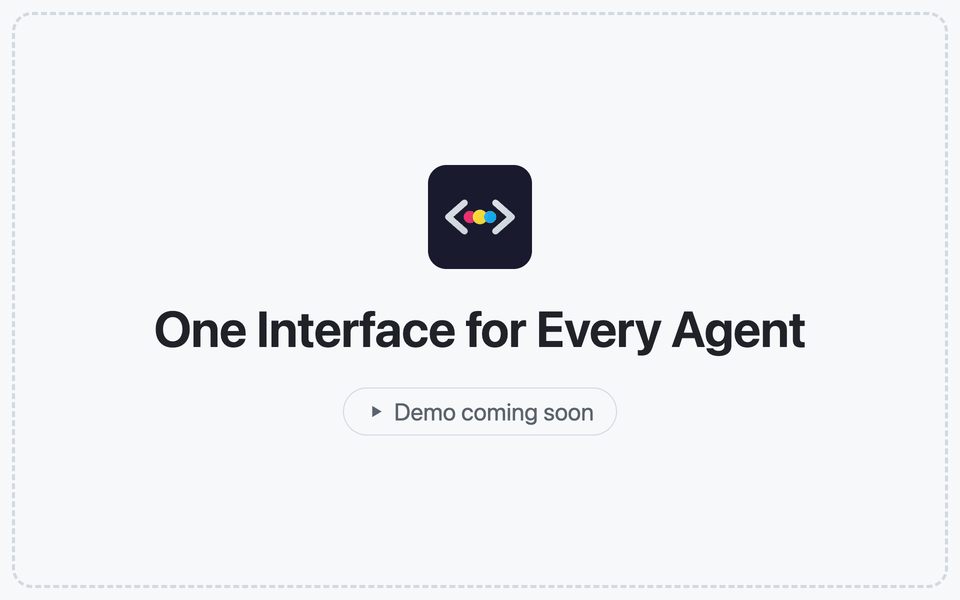
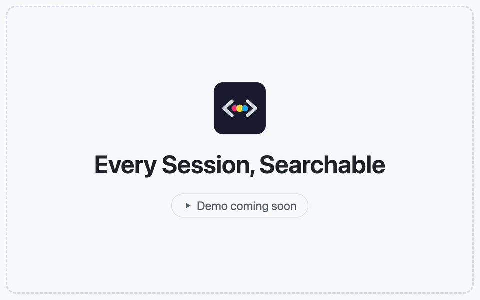
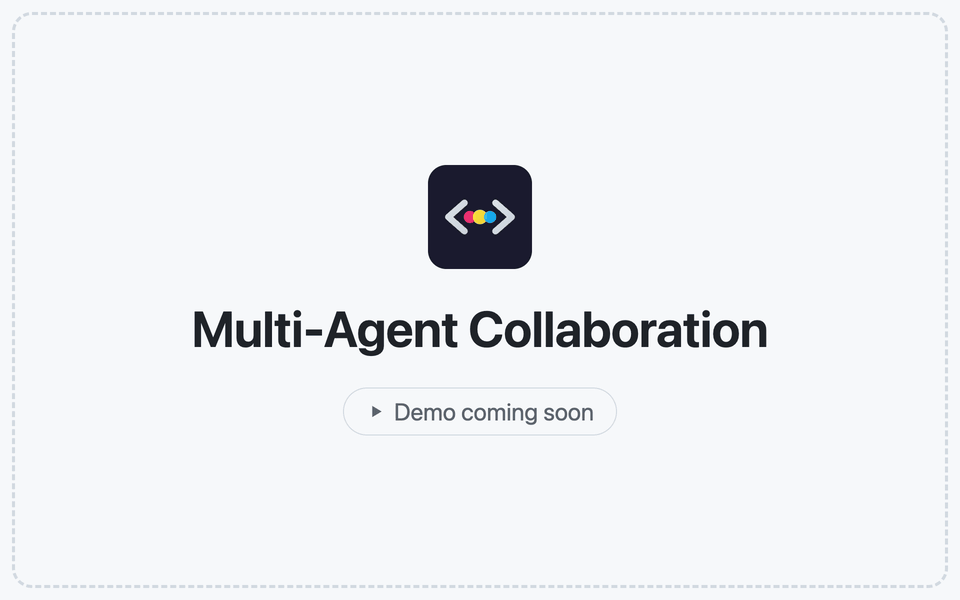
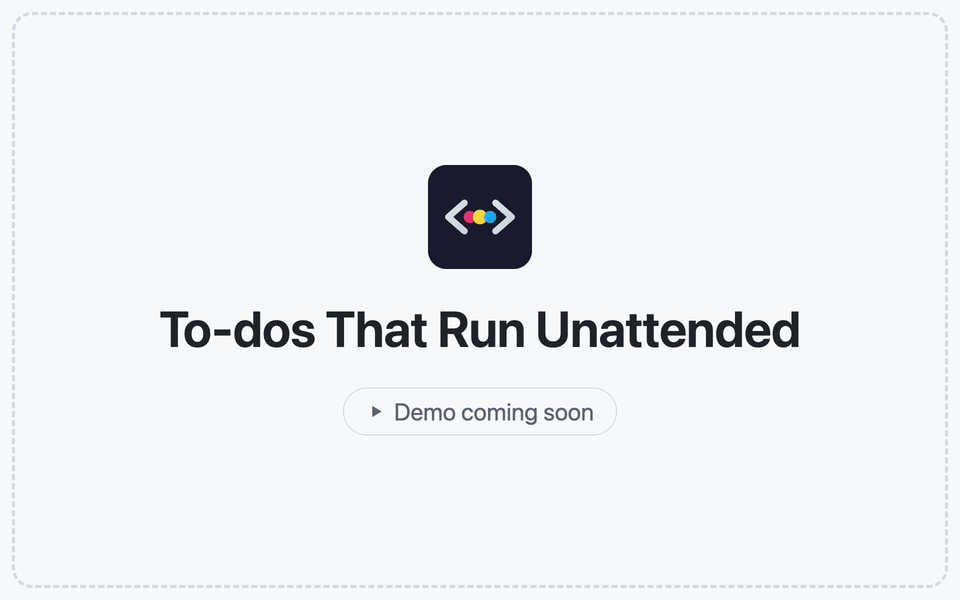
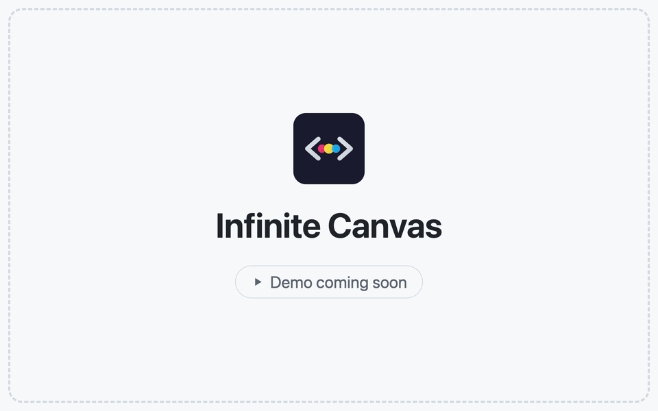
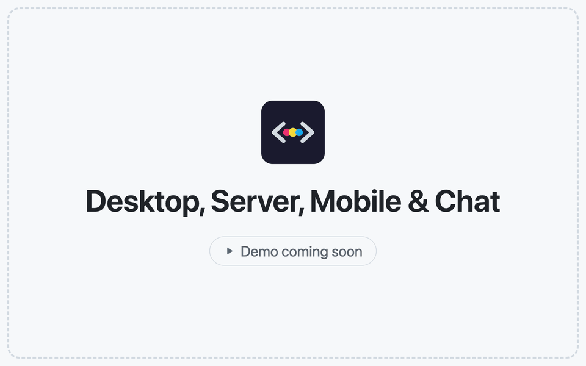
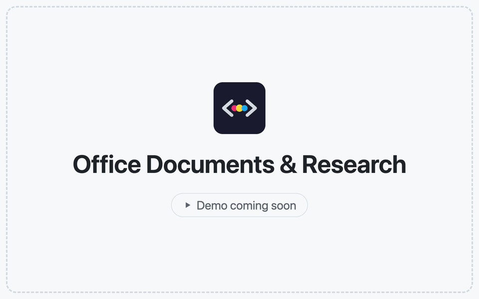
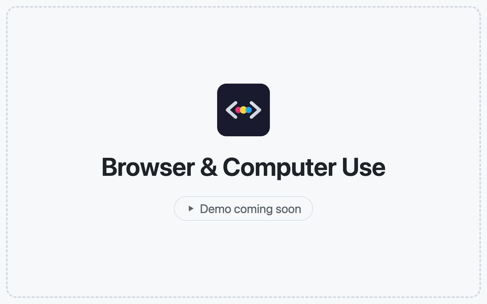

<h1 align="center">
  <a href="https://docs.codeg.app"></a> Codeg
</h1>

<p align="center">
  <a href="https://github.com/icannotwait/MyCodeBuddy"></a>
  <a href="https://github.com/icannotwait/MyCodeBuddy/releases/latest"></a>
  <a href="https://github.com/icannotwait/MyCodeBuddy/releases"></a>
  <a href="./LICENSE"></a>
  <a href="https://docs.codeg.app"></a>
  <a href="https://docs.codeg.app/getting-started/installation"></a>
</p>

<p align="center">
  <sub><strong>English</strong> · <a href="./docs/readme/README.zh-CN.md">简体中文</a> · <a href="./docs/readme/README.zh-TW.md">繁體中文</a> · <a href="./docs/readme/README.ja.md">日本語</a> · <a href="./docs/readme/README.ko.md">한국어</a> · <a href="./docs/readme/README.es.md">Español</a> · <a href="./docs/readme/README.de.md">Deutsch</a> · <a href="./docs/readme/README.fr.md">Français</a> · <a href="./docs/readme/README.pt.md">Português</a> · <a href="./docs/readme/README.ar.md">العربية</a></sub>
</p>

<p align="center">
  <strong>The multi-agent coding workspace.</strong><br/>
  Run every AI coding agent in one place — and let them work together.
</p>

<p align="center"><sub>DrawCode for Windows is published from <a href="https://github.com/icannotwait/MyCodeBuddy">MyCodeBuddy</a>.</sub></p>

<h3 align="center"><a href="https://github.com/icannotwait/MyCodeBuddy/releases/latest"><ins>Download DrawCode</ins></a> · <a href="https://docs.codeg.app"><ins>Documentation</ins></a></h3>

<p align="center">
  <picture>
    <source media="(prefers-color-scheme: dark)" srcset="./docs/images/workspace-dark.png" />
    
  </picture>
</p>

<table>
  <tr>
    <td width="50%" valign="top">🧩 <strong>One interface for every agent</strong><br/>Twenty agents built in, and any ACP agent can join — all rendered as the same structured conversation, not a terminal.</td>
    <td width="50%" valign="top">🔎 <strong>Sessions that travel</strong><br/>Import, search, and resume the history every agent keeps on disk, then hand it to a different agent.</td>
  </tr>
  <tr>
    <td width="50%" valign="top">🤝 <strong>Agents that work together</strong><br/>Delegate across agents with an <code>@</code>, or queue to-dos that run unattended in their own worktrees.</td>
    <td width="50%" valign="top">🌍 <strong>Wherever you work</strong><br/>Desktop app, self-hosted server or Docker, iPhone, iPad, and Android — and Telegram, Lark, or WeChat.</td>
  </tr>
</table>

## ✨ Features

<table>
<tr>
<td width="50%" valign="middle">

### One Interface for Every Agent

Twenty agents come built in, and any other ACP agent can join from the public registry or its distribution JSON. Codeg speaks the Agent Client Protocol to every one of them, so they all get the same rich conversation — tool cards, live diffs, plans, and permission prompts — instead of a terminal to squint at.

[Docs →](https://docs.codeg.app/guide/supported-agents) · [Custom agents →](https://docs.codeg.app/guide/custom-agents) · [UI Render →](https://docs.codeg.app/guide/skills#cards-tables-and-charts-in-replies)

</td>
<td width="50%">
<picture>
  <source media="(prefers-color-scheme: dark)" srcset="./docs/images/features/agents-dark.gif" />
  
</picture>
</td>
</tr>
<tr>
<td width="50%" valign="middle">

### Every Session, Searchable

Import, search, and resume any agent's history. Share sessions with `@` mentions and organize them with tags.

[Docs →](https://docs.codeg.app/guide/aggregation) · [Tags →](https://docs.codeg.app/guide/workspace#tag-conversations)

</td>
<td width="50%">
<picture>
  <source media="(prefers-color-scheme: dark)" srcset="./docs/images/features/sessions-dark.gif" />
  
</picture>
</td>
</tr>
<tr>
<td width="50%" valign="middle">

### Multi-Agent Collaboration

`@` an agent to delegate. Run agents side by side and watch their progress stream into your conversation.

[Docs →](https://docs.codeg.app/guide/multi-agent)

</td>
<td width="50%">
<picture>
  <source media="(prefers-color-scheme: dark)" srcset="./docs/images/features/multi-agent-dark.gif" />
  
</picture>
</td>
</tr>
<tr>
<td width="50%" valign="middle">

### To-dos That Run Unattended

Schedule tasks in isolated worktrees. Agents handle the work; you review and approve the changes.

[Docs →](https://docs.codeg.app/guide/tasks) · [Auto-processing →](https://docs.codeg.app/guide/repository#let-it-pick-items-up-by-itself)

</td>
<td width="50%">
<picture>
  <source media="(prefers-color-scheme: dark)" srcset="./docs/images/features/todos-dark.gif" />
  
</picture>
</td>
</tr>
<tr>
<td width="50%" valign="middle">

### Infinite Canvas

Arrange chats, files, terminals, and notes on an infinite board. Keep every agent's work in view.

[Docs →](https://docs.codeg.app/guide/canvas)

</td>
<td width="50%">
<picture>
  <source media="(prefers-color-scheme: dark)" srcset="./docs/images/features/canvas-dark.gif" />
  
</picture>
</td>
</tr>
<tr>
<td width="50%" valign="middle">

### Desktop, Server, Mobile & Chat

Work on desktop, server, Docker, or mobile. Reach your agents through Telegram, Lark, and WeChat.

[Docs →](https://docs.codeg.app/getting-started/deployment) · [Remote workspaces →](https://docs.codeg.app/guide/workspace#desktop-and-browser) · [Mobile apps →](https://docs.codeg.app/getting-started/installation#mobile-apps) · [Chat channels →](https://docs.codeg.app/guide/chat-channels)

</td>
<td width="50%">
<picture>
  <source media="(prefers-color-scheme: dark)" srcset="./docs/images/features/anywhere-dark.gif" />
  
</picture>
</td>
</tr>
<tr>
<td width="50%" valign="middle">

### Office Documents & Research

Create Office files with live previews and view PDFs beside chat. Research skills work with any agent.

[Docs →](https://docs.codeg.app/guide/office) · [Research →](https://docs.codeg.app/guide/research)

</td>
<td width="50%">
<picture>
  <source media="(prefers-color-scheme: dark)" srcset="./docs/images/features/office-dark.gif" />
  
</picture>
</td>
</tr>
<tr>
<td width="50%" valign="middle">

### Browser & Computer Use

Share pages and errors from the desktop browser. Let agents operate shared windows with Computer Use (preview).

[Docs →](https://docs.codeg.app/guide/browser) · [Computer Use →](https://docs.codeg.app/guide/computer-use)

</td>
<td width="50%">
<picture>
  <source media="(prefers-color-scheme: dark)" srcset="./docs/images/features/browser-dark.gif" />
  
</picture>
</td>
</tr>
<tr>
<td width="50%" valign="middle">

### Command Line & CI

Run prompts from scripts or CI with `codeg-cli`. Connect to a running Codeg for replies or JSON events.

[Docs →](https://docs.codeg.app/guide/command-line)

</td>
<td width="50%" valign="middle">

```bash
codeg-cli -a codex \
  -p "Review the latest commit"

git diff | codeg-cli -a codex \
  -p "Review this diff"
```

</td>
</tr>
</table>

**Also in the box:**

- **[The Full Engineering Loop](https://docs.codeg.app/guide/workspace)** — a code editor, live diffs, [Git & worktrees](https://docs.codeg.app/guide/git), a three-pane merge editor, terminals, and split views
- **[Repository Panel](https://docs.codeg.app/guide/repository)** — issues, pull requests, checks, and merges for GitHub, GitLab, Gitea, and Forgejo; any issue or PR can become a to-do
- **[Automations](https://docs.codeg.app/guide/automations)** — save a configured composer and run it headlessly, on a cron schedule or on demand
- **[Token Usage](https://docs.codeg.app/guide/token-usage)** — trends, cache hit rate, an activity heatmap, usage by folder, agent, model, and session, and what it would cost at API list prices
- **[Fork & Steer](https://docs.codeg.app/guide/workspace#follow-along-%E2%80%94-the-conversation)** — fork a conversation from a finished reply, or send a message into a turn that is still running, on agents that support it
- **[Skills](https://docs.codeg.app/guide/skills) & [MCP](https://docs.codeg.app/guide/mcp)** — skill packs per agent, a local MCP scan, and registry search and install
- **[Project Boot](https://docs.codeg.app/guide/project-boot)** — scaffold a new project visually, with a live preview
- **[Notifications](https://docs.codeg.app/reference/settings/general#desktop-notifications)** — desktop notifications, sounds, and a flashing taskbar button or bouncing Dock icon when a turn ends or an agent needs you
- **[Make It Yours](https://docs.codeg.app/reference/settings/appearance)** — twelve themes you can recolor token by token, wallpapers, corner radius, chat width, custom CSS, and a desktop pet — in any of ten interface languages
- **[Backup & Sync](https://docs.codeg.app/reference/settings/system#backup-restore)** — encrypted backups, and configuration sync between machines through a file or your own WebDAV server
- **[URL Scheme](./docs/url-scheme.md)** — `codeg://session/<id>` opens a conversation from another app (desktop)
- **And more** — nearly every release adds something; the [release notes](https://github.com/icannotwait/MyCodeBuddy/releases) are the full list

## 🤖 Supported Agents

Codeg talks to every agent over the [Agent Client Protocol](https://agentclientprotocol.com), so each one gets the same structured interface. Twenty come built in, and Codeg installs, pins, and updates most of them for you:

<p>
  <a href="https://www.anthropic.com/claude-code"><kbd> Claude Code</kbd></a> &nbsp;
  <a href="https://github.com/openai/codex"><kbd> Codex</kbd></a> &nbsp;
  <a href="https://github.com/google-gemini/gemini-cli"><kbd> Gemini CLI</kbd></a> &nbsp;
  <a href="https://opencode.ai"><kbd><picture><source media="(prefers-color-scheme: dark)" srcset="./docs/images/agents/opencode-dark.svg" /></picture> OpenCode</kbd></a> &nbsp;
  <a href="https://cline.bot"><kbd><picture><source media="(prefers-color-scheme: dark)" srcset="./docs/images/agents/cline-dark.svg" /></picture> Cline</kbd></a> &nbsp;
  <a href="https://hermes-agent.nousresearch.com"><kbd><picture><source media="(prefers-color-scheme: dark)" srcset="./docs/images/agents/hermes-agent-dark.svg" /></picture> Hermes Agent</kbd></a> &nbsp;
  <a href="https://www.codebuddy.ai"><kbd><picture><source media="(prefers-color-scheme: dark)" srcset="./docs/images/agents/codebuddy-dark.svg" /></picture> CodeBuddy</kbd></a> &nbsp;
  <a href="https://www.kimi.com/code"><kbd> Kimi Code</kbd></a> &nbsp;
  <a href="./docs/agents/minimax-code.md"><kbd> MiniMax Code</kbd></a> &nbsp;
  <a href="https://pi.dev"><kbd> Pi</kbd></a> &nbsp;
  <a href="https://x.ai/cli"><kbd><picture><source media="(prefers-color-scheme: dark)" srcset="./docs/images/agents/grok-dark.svg" /></picture> Grok</kbd></a> &nbsp;
  <a href="https://cursor.com/cli"><kbd><picture><source media="(prefers-color-scheme: dark)" srcset="./docs/images/agents/cursor-dark.svg" /></picture> Cursor</kbd></a> &nbsp;
  <a href="https://deepseek-harness.github.io/deepseek-harness/"><kbd> DeepSeek Harness</kbd></a> &nbsp;
  <a href="https://qoder.com"><kbd><picture><source media="(prefers-color-scheme: dark)" srcset="./docs/images/agents/qoder-dark.svg" /></picture> Qoder</kbd></a> &nbsp;
  <a href="https://antigravity.google"><kbd><picture><source media="(prefers-color-scheme: dark)" srcset="./docs/images/agents/google-antigravity-dark.svg" /></picture> Google Antigravity</kbd></a> &nbsp;
  <a href="https://kiro.dev/cli/"><kbd> Kiro CLI</kbd></a> &nbsp;
  <a href="./docs/agents/zcode.md"><kbd> ZCode</kbd></a> &nbsp;
  <a href="https://docs.trae.cn/cli_about-trae-code-cli-2"><kbd> TRAE CLI</kbd></a> &nbsp;
  <a href="https://commandcode.ai"><kbd> Command Code</kbd></a> &nbsp;
  <a href="https://docs.codeg.app/guide/custom-agents"><kbd>+ any ACP agent</kbd></a>
</p>

Not on the list? Pick any agent from the public ACP registry or paste its distribution JSON — Codeg installs it, checks that it launches, and treats it like a built-in. Runtime requirements and where each agent keeps its sessions: [Supported Agents](https://docs.codeg.app/guide/supported-agents).

## 🪟 Split View

One tab strip isn't always enough. Right-click a conversation tab to split the view **right** or **down**, as many times as you like: two panes side by side, a stack of three, a grid. Each group is a workspace of its own — its own tabs, its own header, its own new-conversation button — so Claude Code can refactor in one pane while Codex reviews a diff in the next.

Drag a tab from one group into another and its session keeps streaming through the move; drag the divider between two groups to change how they share the space. Your layout is remembered per workspace, drafts included: reopen Codeg and the split comes back, with the text you never sent still in the box.


## 📦 Install

**Desktop** — GitHub Releases for this repository ship **DrawCode** for Windows (NSIS). Day-to-day use is that desktop installer, not the standalone server.

**Server** — `codeg-server` is opt-in self-host only (Cargo feature `server`). Desktop users should install DrawCode. On Windows, in PowerShell:

```powershell
.\uninstall-server.ps1
# or:
irm https://raw.githubusercontent.com/icannotwait/MyCodeBuddy/main/uninstall-server.ps1 | iex

.\install.ps1 -Version v0.45.0-mycodebuddy.1
# or:
irm https://raw.githubusercontent.com/icannotwait/MyCodeBuddy/main/install.ps1 | iex
$env:CODEG_STATIC_DIR="$env:LOCALAPPDATA\codeg-server\web"; codeg-server
```

The installer defaults to `%LOCALAPPDATA%\codeg-server`, so it does not overwrite a DrawCode desktop install. If an older install shared the desktop folder, the script moves the server out of it.

[GitHub Releases](https://github.com/icannotwait/MyCodeBuddy/releases) also provide signed self-hosted server archives: `codeg-server-linux-x64.tar.gz`, `codeg-server-linux-arm64.tar.gz`, `codeg-server-darwin-x64.tar.gz`, `codeg-server-darwin-arm64.tar.gz`, and `codeg-server-windows-x64.zip`. Each includes the server, MCP companion, computer helper, `web/` assets, and license files.

**Docker** — build the optional server from this repository:

```bash
docker compose up -d
```

Docker Compose builds the image locally and enables Cargo feature `server`. Data stays in the `/data` volume; token, port, and project mounts are in `docker-compose.yml`.

**From source** — `codeg-server` needs `--features server`, and `codeg-mcp` needs `--features mcp-bin`:

```bash
pnpm install && pnpm build
cd src-tauri
cargo build --release --bin codeg-server --no-default-features --features server
cargo build --release --bin codeg-mcp --no-default-features --features mcp-bin
# Only if computer use is enabled:
cargo build --release --bin codeg-computer-helper --no-default-features --features computer-helper
cargo build --release --bin codeg-cli --no-default-features --features cli-bin
CODEG_STATIC_DIR=../out ./target/release/codeg-server
```

**Source-built Linux/macOS upgrades** — Run from the repository root to pull source and rebuild:

```bash
git pull
pnpm install && pnpm build
cd src-tauri
cargo build --release --bin codeg-server --no-default-features --features server
cargo build --release --bin codeg-mcp --no-default-features --features mcp-bin
# Only if computer use is enabled:
cargo build --release --bin codeg-computer-helper --no-default-features --features computer-helper
cargo build --release --bin codeg-cli --no-default-features --features cli-bin
# Stop the service, redeploy the server, MCP companion, optional computer helper, and web assets, then restart.
```

For Docker upgrades, run `git pull && docker compose up --build -d --force-recreate` from the repository root.

**Mobile** — install the [iOS app](https://apps.apple.com/app/codeg-client/id6785199071) or the [Android APK](https://github.com/xintaofei/codeg-android/releases/latest), then point it at the **Web Service** of your desktop app or at your own `codeg-server`: URL, token, done. Pairing steps in [Mobile apps](https://docs.codeg.app/getting-started/installation#mobile-apps).

Compose, prebuilt binaries, source builds, and in-place updates are covered in [Deployment](https://docs.codeg.app/getting-started/deployment); environment variables in [Configuration](https://docs.codeg.app/getting-started/configuration).

## 👥 Community & Support

- **WeChat** — scan the QR code to join our group for discussions, feedback, and updates:

  <picture>
    <source media="(prefers-color-scheme: dark)" srcset="./docs/images/weixin-dark.jpg" />
    
  </picture>

- **Issues** — found a bug or missing a feature? [Open an issue](https://github.com/icannotwait/MyCodeBuddy/issues).
- **Privacy** — local-first: parsing, storage, and project operations stay on your machine, and web and server modes are guarded by token authentication. Details in [Privacy & Security](https://docs.codeg.app/reference/privacy).
- **LinuxDO** — thanks to the [LinuxDO](https://linux.do) community for their support.
- **Show support** — [star the repo](https://github.com/icannotwait/MyCodeBuddy) to follow along.

## 🤝 Contributing

Issues and pull requests are welcome. To build Codeg yourself, start with [Development](https://docs.codeg.app/reference/development) and [Architecture](https://docs.codeg.app/reference/architecture).

<a href="https://github.com/icannotwait/MyCodeBuddy/graphs/contributors">
  
</a>

## ⭐ Star History

<a href="https://www.star-history.com/?repos=icannotwait%2FMyCodeBuddy&type=date&releases=&legend=bottom-right">
 <picture>
   <source media="(prefers-color-scheme: dark)" srcset="https://api.star-history.com/chart?repos=icannotwait/MyCodeBuddy&type=date&theme=dark&legend=bottom-right" />
   <source media="(prefers-color-scheme: light)" srcset="https://api.star-history.com/chart?repos=icannotwait/MyCodeBuddy&type=date&legend=bottom-right" />
   
 </picture>
</a>

## 🙏 Acknowledgments

- MyCodeBuddy publishes DrawCode. It is a fork of the original Codeg project; releases and installers come from this repository.

- [Agent Client Protocol](https://agentclientprotocol.com) — the foundation that lets Codeg connect to every agent it supports
- [Superpowers](https://github.com/obra/superpowers) — powers Codeg's expert skills module
- [OfficeCLI](https://github.com/iOfficeAI/OfficeCLI) — powers Codeg's Office documents workflow
- [scientific-agent-skills](https://github.com/K-Dense-AI/scientific-agent-skills) — powers Codeg's Scientific Research skills (MIT-licensed subset)
- [json-render](https://github.com/vercel-labs/json-render) — powers Codeg's UI Render cards, tables, and charts
- [cua-driver](https://github.com/trycua/cua) — powers Codeg's Computer Use

## 📜 License

Apache-2.0. See [LICENSE](./LICENSE).
