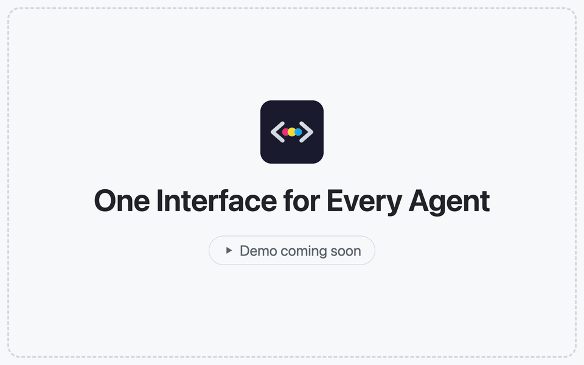
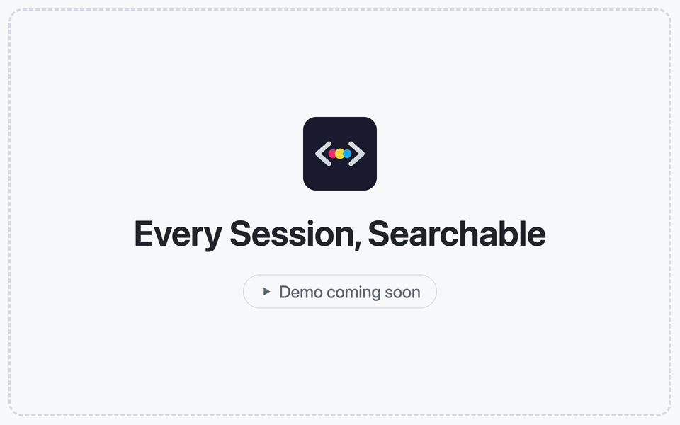
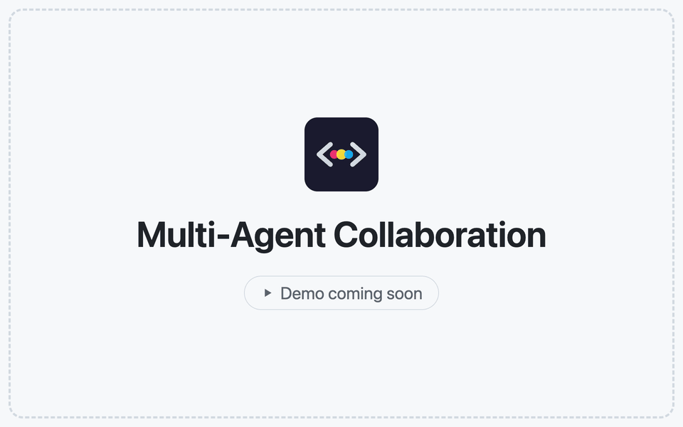
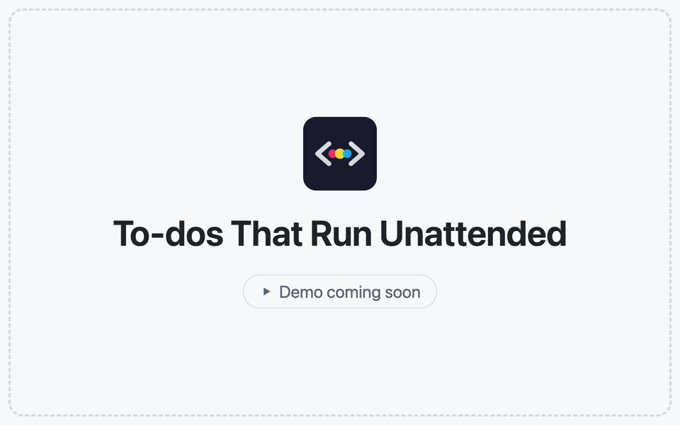
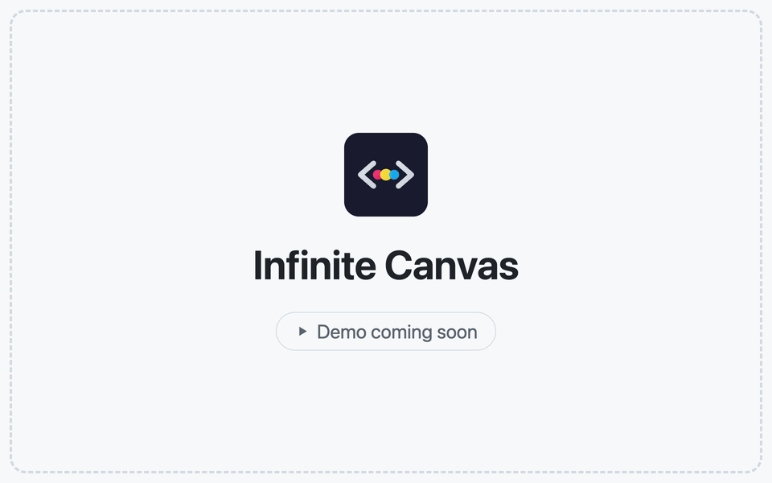
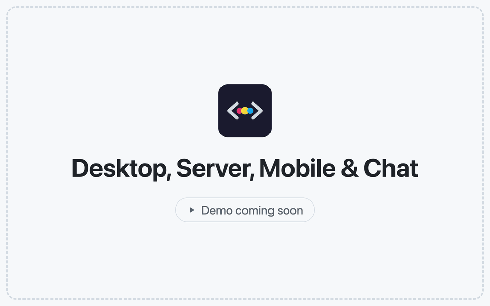
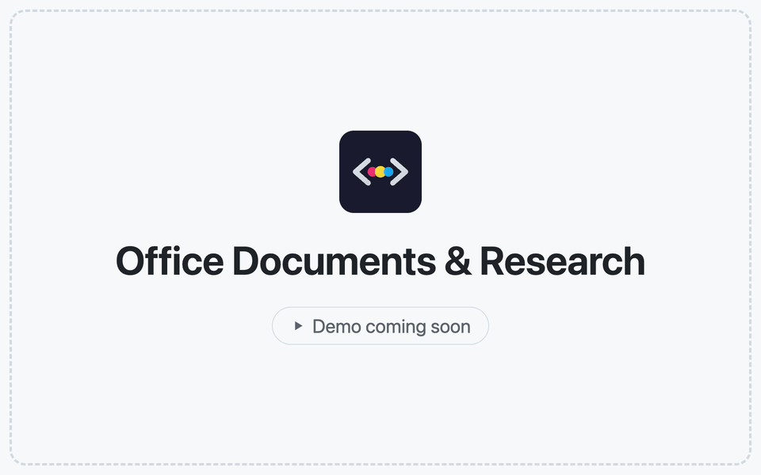
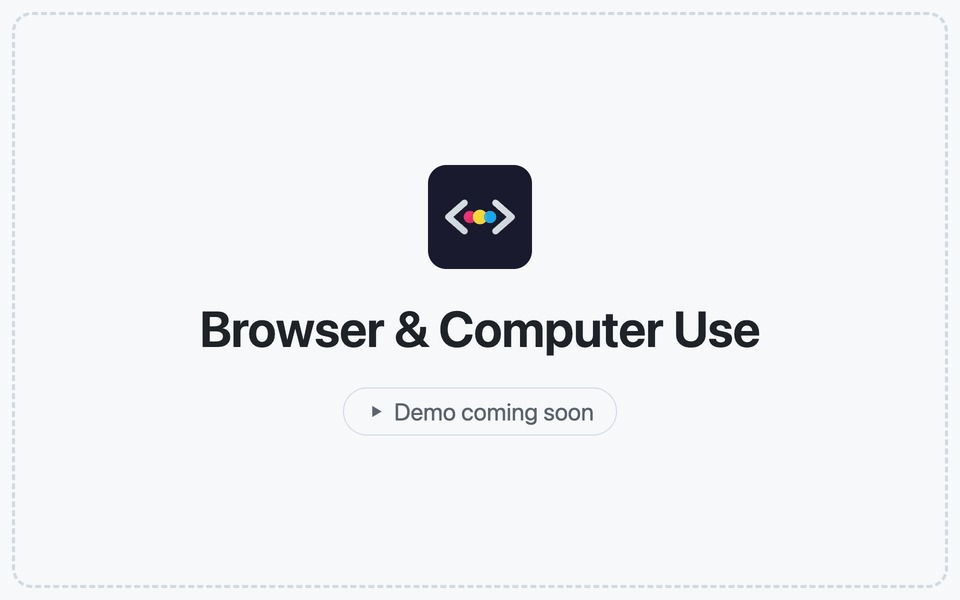

<h1 align="center">
  <a href="https://docs.codeg.app"></a> Codeg
</h1>

<p align="center">
  <a href="https://github.com/icannotwait/MyCodeBuddy"></a>
  <a href="https://github.com/icannotwait/MyCodeBuddy/releases/latest"></a>
  <a href="https://github.com/icannotwait/MyCodeBuddy/releases"></a>
  <a href="../../LICENSE"></a>
  <a href="https://docs.codeg.app"></a>
  <a href="https://docs.codeg.app/getting-started/installation"></a>
</p>

<p align="center">
  <sub><a href="../../README.md">English</a> · <a href="./README.zh-CN.md">简体中文</a> · <a href="./README.zh-TW.md">繁體中文</a> · <a href="./README.ja.md">日本語</a> · <a href="./README.ko.md">한국어</a> · <a href="./README.es.md">Español</a> · <strong>Deutsch</strong> · <a href="./README.fr.md">Français</a> · <a href="./README.pt.md">Português</a> · <a href="./README.ar.md">العربية</a></sub>
</p>

<p align="center">
  <strong>Der Multi-Agent-Coding-Workspace.</strong><br/>
  Führe jeden KI-Coding-Agenten an einem Ort aus — und lass sie zusammenarbeiten.
</p>

<p align="center"><sub>DrawCode für Windows erscheint über <a href="https://github.com/icannotwait/MyCodeBuddy">MyCodeBuddy</a>.</sub></p>

<h3 align="center"><a href="https://github.com/icannotwait/MyCodeBuddy/releases/latest"><ins>DrawCode herunterladen</ins></a> · <a href="https://docs.codeg.app"><ins>Dokumentation</ins></a></h3>

<p align="center">
  <picture>
    <source media="(prefers-color-scheme: dark)" srcset="../images/workspace-dark.png" />
    
  </picture>
</p>

<table>
  <tr>
    <td width="50%" valign="top">🧩 <strong>Eine Oberfläche für alle Agenten</strong><br/>Zwanzig Agenten sind eingebaut, und jeder ACP-Agent kann dazukommen — alle dargestellt als dieselbe strukturierte Unterhaltung, nicht als Terminal.</td>
    <td width="50%" valign="top">🔎 <strong>Sitzungen zum Mitnehmen</strong><br/>Importiere, durchsuche und setze die Historie fort, die jeder Agent auf der Festplatte ablegt, und übergib sie dann an einen anderen Agenten.</td>
  </tr>
  <tr>
    <td width="50%" valign="top">🤝 <strong>Agenten, die zusammenarbeiten</strong><br/>Delegiere agentenübergreifend mit einem <code>@</code>, oder stell To-dos in die Warteschlange, die unbeaufsichtigt in ihren eigenen Worktrees laufen.</td>
    <td width="50%" valign="top">🌍 <strong>Wo immer du arbeitest</strong><br/>Desktop-App, selbst gehosteter Server oder Docker, iPhone, iPad und Android — und Telegram, Lark oder WeChat.</td>
  </tr>
</table>

## ✨ Funktionen

<table>
<tr>
<td width="50%" valign="middle">

### Eine Oberfläche für alle Agenten

Zwanzig Agenten sind eingebaut, und jeder weitere ACP-Agent kann aus der öffentlichen Registry oder über sein Distribution-JSON dazukommen. Codeg spricht mit jedem von ihnen über das Agent Client Protocol, sodass alle dieselbe reichhaltige Unterhaltung bekommen — Tool-Karten, Live-Diffs, Pläne und Berechtigungsanfragen — statt eines Terminals, vor dem du die Augen zusammenkneifst.

[Doku →](https://docs.codeg.app/guide/supported-agents) · [Eigene Agenten →](https://docs.codeg.app/guide/custom-agents) · [UI-Rendering →](https://docs.codeg.app/guide/skills#cards-tables-and-charts-in-replies)

</td>
<td width="50%">
<picture>
  <source media="(prefers-color-scheme: dark)" srcset="../images/features/agents-dark.gif" />
  
</picture>
</td>
</tr>
<tr>
<td width="50%" valign="middle">

### Jede Sitzung durchsuchbar

Verläufe importieren, durchsuchen und fortsetzen. Mit `@` teilen und mit Tags ordnen.

[Doku →](https://docs.codeg.app/guide/aggregation) · [Tags →](https://docs.codeg.app/guide/workspace#tag-conversations)

</td>
<td width="50%">
<picture>
  <source media="(prefers-color-scheme: dark)" srcset="../images/features/sessions-dark.gif" />
  
</picture>
</td>
</tr>
<tr>
<td width="50%" valign="middle">

### Multi-Agent-Zusammenarbeit

Mit `@` Aufgaben delegieren. Agenten arbeiten parallel und melden ihren Fortschritt direkt im Chat.

[Doku →](https://docs.codeg.app/guide/multi-agent)

</td>
<td width="50%">
<picture>
  <source media="(prefers-color-scheme: dark)" srcset="../images/features/multi-agent-dark.gif" />
  
</picture>
</td>
</tr>
<tr>
<td width="50%" valign="middle">

### To-dos, die unbeaufsichtigt laufen

Aufgaben sofort oder geplant in eigenen Worktrees ausführen. Du prüfst und bestätigst die Änderungen.

[Doku →](https://docs.codeg.app/guide/tasks) · [Automatische Verarbeitung →](https://docs.codeg.app/guide/repository#let-it-pick-items-up-by-itself)

</td>
<td width="50%">
<picture>
  <source media="(prefers-color-scheme: dark)" srcset="../images/features/todos-dark.gif" />
  
</picture>
</td>
</tr>
<tr>
<td width="50%" valign="middle">

### Unendlicher Canvas

Chats, Dateien, Terminals und Notizen auf einem endlosen Board anordnen. Alle Agenten im Blick.

[Doku →](https://docs.codeg.app/guide/canvas)

</td>
<td width="50%">
<picture>
  <source media="(prefers-color-scheme: dark)" srcset="../images/features/canvas-dark.gif" />
  
</picture>
</td>
</tr>
<tr>
<td width="50%" valign="middle">

### Desktop, Server, Mobil & Chat

Desktop, Server, Docker oder mobil: Nutze deine Agenten auch über Telegram, Lark und WeChat.

[Doku →](https://docs.codeg.app/getting-started/deployment) · [Remote-Arbeitsbereiche →](https://docs.codeg.app/guide/workspace#desktop-and-browser) · [Mobile Apps →](https://docs.codeg.app/getting-started/installation#mobile-apps) · [Chat-Kanäle →](https://docs.codeg.app/guide/chat-channels)

</td>
<td width="50%">
<picture>
  <source media="(prefers-color-scheme: dark)" srcset="../images/features/anywhere-dark.gif" />
  
</picture>
</td>
</tr>
<tr>
<td width="50%" valign="middle">

### Office-Dokumente & Forschung

Office-Dateien mit Live-Vorschau erstellen und PDFs ansehen. Forschungsskills für jeden Agenten.

[Doku →](https://docs.codeg.app/guide/office) · [Forschung →](https://docs.codeg.app/guide/research)

</td>
<td width="50%">
<picture>
  <source media="(prefers-color-scheme: dark)" srcset="../images/features/office-dark.gif" />
  
</picture>
</td>
</tr>
<tr>
<td width="50%" valign="middle">

### Browser- & Computernutzung

Seiten und Fehler im Desktop-Browser teilen. Computer Use (Vorschau) steuert freigegebene Fenster.

[Doku →](https://docs.codeg.app/guide/browser) · [Computernutzung →](https://docs.codeg.app/guide/computer-use)

</td>
<td width="50%">
<picture>
  <source media="(prefers-color-scheme: dark)" srcset="../images/features/browser-dark.gif" />
  
</picture>
</td>
</tr>
<tr>
<td width="50%" valign="middle">

### Kommandozeile & CI

`codeg-cli` verbindet Skripte und CI mit einem laufenden Codeg und liefert Antworten oder JSON-Ereignisse.

[Doku →](https://docs.codeg.app/guide/command-line)

</td>
<td width="50%" valign="middle">

```bash
codeg-cli -a codex \
  -p "Review the latest commit"

git diff | codeg-cli -a codex \
  -p "Review this diff"
```

</td>
</tr>
</table>

**Außerdem mit an Bord:**

- **[Der komplette Engineering-Loop](https://docs.codeg.app/guide/workspace)** — Code-Editor, Live-Diffs, [Git & Worktrees](https://docs.codeg.app/guide/git), Drei-Fenster-Merge-Editor, Terminals und geteilte Ansichten
- **[Repository-Panel](https://docs.codeg.app/guide/repository)** — Issues, Pull Requests, Checks und Merges für GitHub, GitLab, Gitea und Forgejo; aus jedem Issue oder PR kann ein To-do werden
- **[Automatisierungen](https://docs.codeg.app/guide/automations)** — einen konfigurierten Composer speichern und headless ausführen, nach Cron-Zeitplan oder bei Bedarf
- **[Token-Nutzung](https://docs.codeg.app/guide/token-usage)** — Verläufe, Cache-Trefferquote, eine Aktivitäts-Heatmap, Nutzung nach Ordner, Agent, Modell und Sitzung und was das zu API-Listenpreisen kosten würde
- **[Verzweigen & Nachsteuern](https://docs.codeg.app/guide/workspace#follow-along-%E2%80%94-the-conversation)** — bei Agenten, die das unterstützen, eine Unterhaltung ab einer abgeschlossenen Antwort verzweigen oder eine Nachricht in einen noch laufenden Turn schicken
- **[Skills](https://docs.codeg.app/guide/skills) & [MCP](https://docs.codeg.app/guide/mcp)** — Skill-Pakete pro Agent, ein lokaler MCP-Scan sowie Suche und Installation aus der Registry
- **[Projekt-Boot](https://docs.codeg.app/guide/project-boot)** — ein neues Projekt visuell aufsetzen, mit Live-Vorschau
- **[Benachrichtigungen](https://docs.codeg.app/reference/settings/general#desktop-notifications)** — Desktop-Benachrichtigungen, Töne und eine blinkende Taskleisten-Schaltfläche oder ein hüpfendes Dock-Symbol, wenn ein Turn endet oder ein Agent dich braucht
- **[Mach es zu deinem](https://docs.codeg.app/reference/settings/appearance)** — zwölf Themes, die du Token für Token umfärben kannst, Hintergrundbilder, Eckenradius, Chat-Breite, eigenes CSS und ein Desktop-Pet — in jeder der zehn Oberflächensprachen
- **[Sicherung & Synchronisierung](https://docs.codeg.app/reference/settings/system#backup-restore)** — verschlüsselte Sicherungen sowie Konfigurationssynchronisierung zwischen Rechnern über eine Datei oder deinen eigenen WebDAV-Server
- **[URL-Schema](../../docs/url-scheme.md)** — `codeg://session/<id>` öffnet eine Unterhaltung aus einer anderen App heraus (Desktop)
- **Und noch mehr** — fast jede Version bringt etwas Neues; die vollständige Liste steht in den [Versionshinweisen](https://github.com/icannotwait/MyCodeBuddy/releases)

## 🤖 Unterstützte Agenten

Codeg spricht mit jedem Agenten über das [Agent Client Protocol](https://agentclientprotocol.com), sodass jeder dieselbe strukturierte Oberfläche bekommt. Zwanzig sind eingebaut, und die meisten davon installiert, fixiert und aktualisiert Codeg für dich:

<p>
  <a href="https://www.anthropic.com/claude-code"><kbd> Claude Code</kbd></a> &nbsp;
  <a href="https://github.com/openai/codex"><kbd> Codex</kbd></a> &nbsp;
  <a href="https://github.com/google-gemini/gemini-cli"><kbd> Gemini CLI</kbd></a> &nbsp;
  <a href="https://opencode.ai"><kbd><picture><source media="(prefers-color-scheme: dark)" srcset="../images/agents/opencode-dark.svg" /></picture> OpenCode</kbd></a> &nbsp;
  <a href="https://cline.bot"><kbd><picture><source media="(prefers-color-scheme: dark)" srcset="../images/agents/cline-dark.svg" /></picture> Cline</kbd></a> &nbsp;
  <a href="https://hermes-agent.nousresearch.com"><kbd><picture><source media="(prefers-color-scheme: dark)" srcset="../images/agents/hermes-agent-dark.svg" /></picture> Hermes Agent</kbd></a> &nbsp;
  <a href="https://www.codebuddy.ai"><kbd><picture><source media="(prefers-color-scheme: dark)" srcset="../images/agents/codebuddy-dark.svg" /></picture> CodeBuddy</kbd></a> &nbsp;
  <a href="https://www.kimi.com/code"><kbd> Kimi Code</kbd></a> &nbsp;
  <a href="../agents/minimax-code.md"><kbd> MiniMax Code</kbd></a> &nbsp;
  <a href="https://pi.dev"><kbd> Pi</kbd></a> &nbsp;
  <a href="https://x.ai/cli"><kbd><picture><source media="(prefers-color-scheme: dark)" srcset="../images/agents/grok-dark.svg" /></picture> Grok</kbd></a> &nbsp;
  <a href="https://cursor.com/cli"><kbd><picture><source media="(prefers-color-scheme: dark)" srcset="../images/agents/cursor-dark.svg" /></picture> Cursor</kbd></a> &nbsp;
  <a href="https://deepseek-harness.github.io/deepseek-harness/"><kbd> DeepSeek Harness</kbd></a> &nbsp;
  <a href="https://qoder.com"><kbd><picture><source media="(prefers-color-scheme: dark)" srcset="../images/agents/qoder-dark.svg" /></picture> Qoder</kbd></a> &nbsp;
  <a href="https://antigravity.google"><kbd><picture><source media="(prefers-color-scheme: dark)" srcset="../images/agents/google-antigravity-dark.svg" /></picture> Google Antigravity</kbd></a> &nbsp;
  <a href="https://kiro.dev/cli/"><kbd> Kiro CLI</kbd></a> &nbsp;
  <a href="../agents/zcode.md"><kbd> ZCode</kbd></a> &nbsp;
  <a href="https://docs.trae.cn/cli_about-trae-code-cli-2"><kbd> TRAE CLI</kbd></a> &nbsp;
  <a href="https://commandcode.ai"><kbd> Command Code</kbd></a> &nbsp;
  <a href="https://docs.codeg.app/guide/custom-agents"><kbd>+ jeder ACP-Agent</kbd></a>
</p>

Nicht dabei? Wähle einen beliebigen Agenten aus der öffentlichen ACP-Registry oder füge sein Distribution-JSON ein — Codeg installiert ihn, prüft, ob er startet, und behandelt ihn wie einen eingebauten. Laufzeit-Anforderungen und wo jeder Agent seine Sitzungen ablegt: [Unterstützte Agenten](https://docs.codeg.app/guide/supported-agents).

## 🪟 Split-Ansicht

Eine Tab-Leiste reicht nicht immer. Ein Rechtsklick auf einen Unterhaltungs-Tab teilt die Ansicht **nach rechts** oder **nach unten** — beliebig oft: zwei Panes nebeneinander, drei gestapelt, ein Raster. Jede Gruppe ist ein vollwertiger Workspace — eigene Tabs, eigener Header, eigener Button für eine neue Unterhaltung — so refaktoriert Claude Code im einen Pane, während Codex im nächsten einen Diff prüft.

Zieh einen Tab von einer Gruppe in die andere: Seine Sitzung streamt während des Umzugs weiter. Zieh den Teiler zwischen zwei Gruppen, um den Platz anders aufzuteilen. Das Layout wird pro Workspace gemerkt, Entwürfe inklusive — öffne Codeg wieder, und die Aufteilung ist zurück, mit dem nie abgesendeten Text noch im Eingabefeld.


## 📦 Installation

**Desktop** — die GitHub Releases dieses Repositorys liefern **DrawCode** für Windows (NSIS). Für den Alltag ist das der Desktop-Installer.

**Server** — `codeg-server` ist nur für Self-Hosting gedacht (Cargo-Feature `server`). Desktop-Nutzer installieren DrawCode. Unter Windows, in PowerShell:

```powershell
.\uninstall-server.ps1
# or:
irm https://raw.githubusercontent.com/icannotwait/MyCodeBuddy/main/uninstall-server.ps1 | iex

.\install.ps1 -Version v0.47.0-mycodebuddy.1
# or:
irm https://raw.githubusercontent.com/icannotwait/MyCodeBuddy/main/install.ps1 | iex
$env:CODEG_STATIC_DIR="$env:LOCALAPPDATA\codeg-server\web"; codeg-server
```

Der Installer verwendet standardmäßig `%LOCALAPPDATA%\codeg-server` und überschreibt damit keine DrawCode-Desktop-Installation. Liegt eine ältere Installation im Desktop-Ordner, verschiebt das Skript den Server dort heraus.

[GitHub Releases](https://github.com/icannotwait/MyCodeBuddy/releases) bieten auch signierte Server-Archive für Self-Hosting: `codeg-server-linux-x64.tar.gz`, `codeg-server-linux-arm64.tar.gz`, `codeg-server-darwin-x64.tar.gz`, `codeg-server-darwin-arm64.tar.gz` und `codeg-server-windows-x64.zip`. Jedes enthält den Server, den MCP-Begleitprozess, den Computer-Helper, `web/`-Assets und Lizenzdateien.

**Docker** — den optionalen Server aus diesem Repository bauen:

```bash
docker compose up -d
```

Docker Compose baut das Image lokal und aktiviert das Cargo-Feature `server`. Die Daten bleiben im Volume `/data`; Token, Port und Projekt-Mounts stehen in `docker-compose.yml`.

**Aus dem Quellcode** — `codeg-server` braucht `--features server`, `codeg-mcp` braucht `--features mcp-bin`:

```bash
pnpm install && pnpm build
cd src-tauri
cargo build --release --bin codeg-server --no-default-features --features server
cargo build --release --bin codeg-mcp --no-default-features --features mcp-bin
# Nur wenn die Computersteuerung aktiviert ist:
cargo build --release --bin codeg-computer-helper --no-default-features --features computer-helper
CODEG_STATIC_DIR=../out ./target/release/codeg-server
```

**Upgrades quellcodebasierter Linux/macOS-Installationen** — Im Repository-Stamm ausführen, um den Quellcode abzurufen und neu zu bauen:

```bash
git pull
pnpm install && pnpm build
cd src-tauri
cargo build --release --bin codeg-server --no-default-features --features server
cargo build --release --bin codeg-mcp --no-default-features --features mcp-bin
# Nur wenn die Computersteuerung aktiviert ist:
cargo build --release --bin codeg-computer-helper --no-default-features --features computer-helper
# Dienst stoppen, Server, MCP-Begleitprozess, optionalen Computer-Helper und Web-Assets neu bereitstellen, dann neu starten.
```

Für Docker-Upgrades im Repository-Stamm `git pull && docker compose up --build -d --force-recreate` ausführen.

**Mobil** — installiere die [iOS-App](https://apps.apple.com/app/codeg-client/id6785199071) oder das [Android-APK](https://github.com/xintaofei/codeg-android/releases/latest) und richte sie auf den **Webdienst** deiner Desktop-App oder auf deinen eigenen `codeg-server`: URL, Token, fertig. Die Kopplungsschritte stehen in [Mobile Apps](https://docs.codeg.app/getting-started/installation#mobile-apps).

Compose, vorgebaute Binaries, Builds aus dem Quellcode und In-place-Updates stehen unter [Deployment](https://docs.codeg.app/getting-started/deployment); Umgebungsvariablen unter [Konfiguration](https://docs.codeg.app/getting-started/configuration).

## 👥 Community & Support

- **WeChat** — scanne den QR-Code, um unserer Gruppe für Diskussionen, Feedback und Updates beizutreten:

  <picture>
    <source media="(prefers-color-scheme: dark)" srcset="../images/weixin-dark.jpg" />
    
  </picture>

- **Issues** — einen Bug gefunden oder eine Funktion vermisst? [Eröffne ein Issue](https://github.com/icannotwait/MyCodeBuddy/issues).
- **Datenschutz** — local-first: Parsing, Speicherung und Projektoperationen bleiben auf deinem Rechner, und Web- und Server-Modus sind durch Token-basierte Authentifizierung geschützt. Details unter [Datenschutz und Sicherheit](https://docs.codeg.app/reference/privacy).
- **LinuxDO** — danke an die [LinuxDO](https://linux.do)-Community für ihre Unterstützung.
- **Unterstütze uns** — [gib dem Repo einen Stern](https://github.com/icannotwait/MyCodeBuddy), um auf dem Laufenden zu bleiben.

## 🤝 Mitwirken

Issues und Pull Requests sind willkommen. Wenn du Codeg selbst bauen willst, beginne mit [Entwicklung](https://docs.codeg.app/reference/development) und [Architektur](https://docs.codeg.app/reference/architecture).

<a href="https://github.com/icannotwait/MyCodeBuddy/graphs/contributors">
  
</a>

## ⭐ Star-Verlauf

<a href="https://www.star-history.com/?repos=icannotwait%2FMyCodeBuddy&type=date&releases=&legend=bottom-right">
 <picture>
   <source media="(prefers-color-scheme: dark)" srcset="https://api.star-history.com/chart?repos=icannotwait/MyCodeBuddy&type=date&theme=dark&legend=bottom-right" />
   <source media="(prefers-color-scheme: light)" srcset="https://api.star-history.com/chart?repos=icannotwait/MyCodeBuddy&type=date&legend=bottom-right" />
   
 </picture>
</a>

## 🙏 Danksagungen

- MyCodeBuddy veröffentlicht DrawCode. Es ist ein Fork des ursprünglichen Codeg-Projekts; Releases und Installer kommen aus diesem Repository.

- [Agent Client Protocol](https://agentclientprotocol.com) — die Grundlage, auf der Codeg sich mit jedem unterstützten Agenten verbindet
- [Superpowers](https://github.com/obra/superpowers) — unterstützt das Experten-Skills-Modul von Codeg
- [OfficeCLI](https://github.com/iOfficeAI/OfficeCLI) — unterstützt den Office-Dokument-Workflow von Codeg
- [scientific-agent-skills](https://github.com/K-Dense-AI/scientific-agent-skills) — unterstützt die wissenschaftlichen Forschungs-Skills von Codeg (MIT-lizenzierte Teilmenge)
- [json-render](https://github.com/vercel-labs/json-render) — unterstützt die Karten, Tabellen und Diagramme des UI-Renderings von Codeg
- [cua-driver](https://github.com/trycua/cua) — unterstützt die Computernutzung von Codeg

## 📜 Lizenz

Apache-2.0. Siehe [LICENSE](../../LICENSE).
