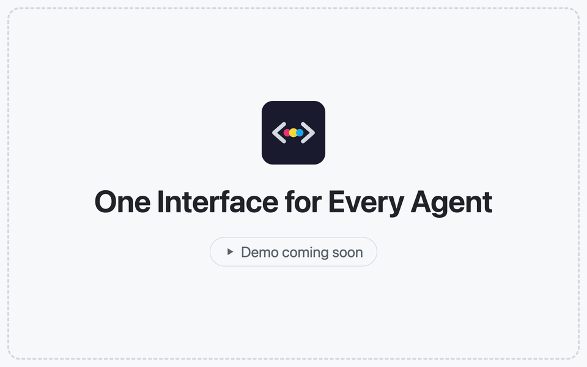
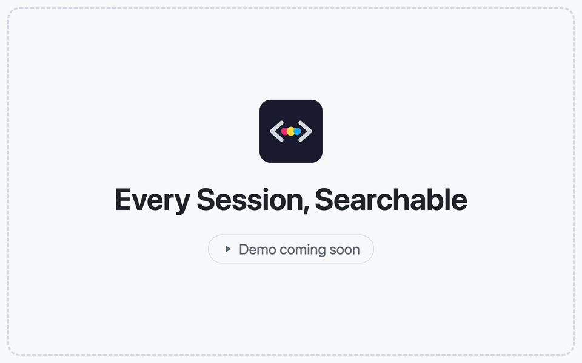
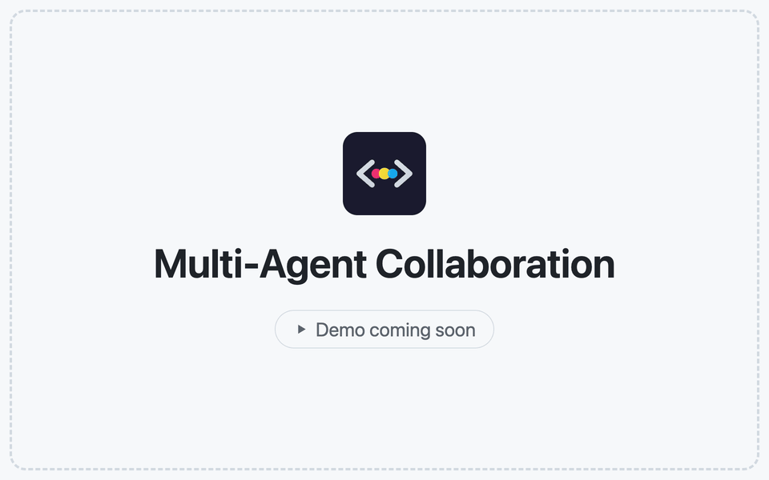
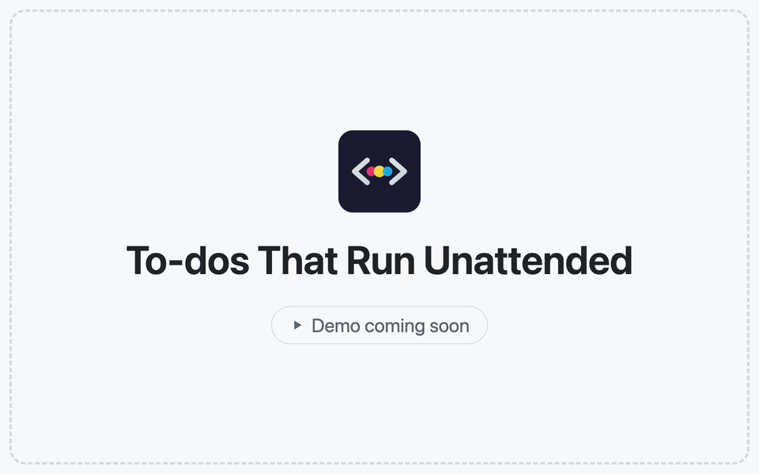
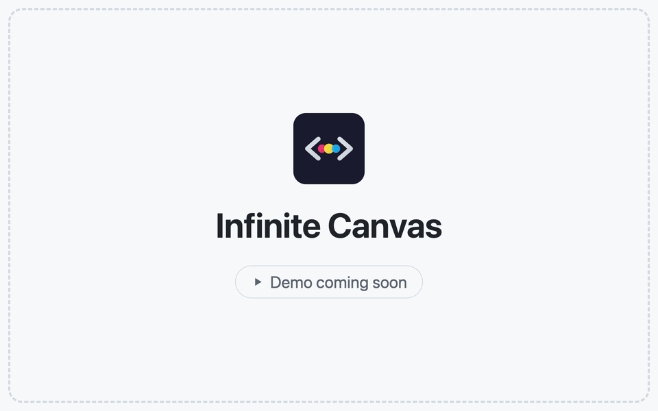
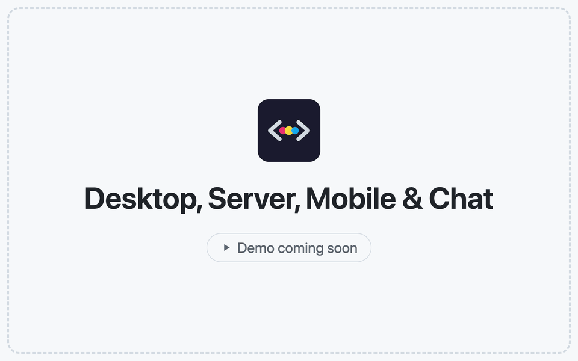
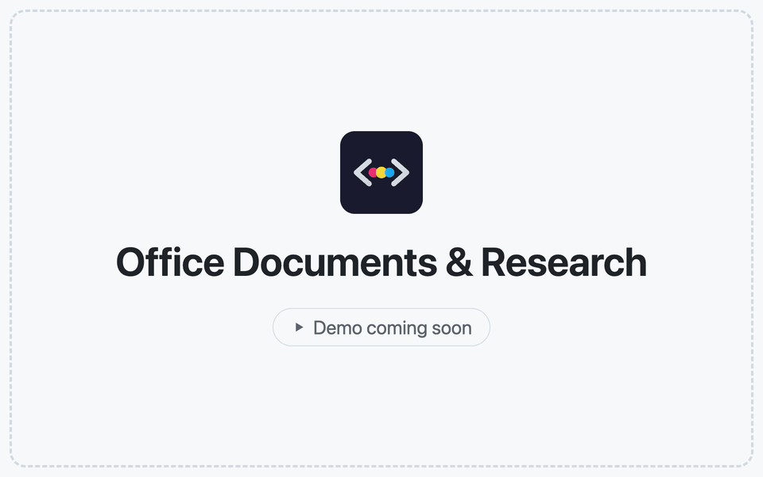
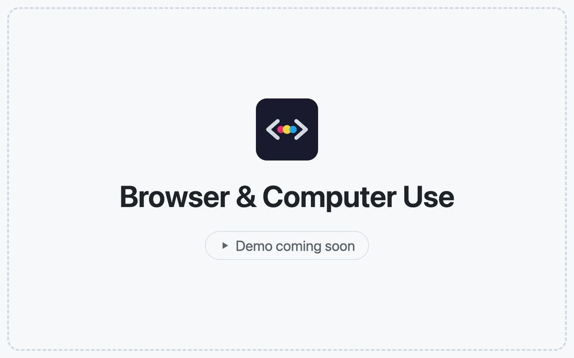

<h1 align="center">
  <a href="https://docs.codeg.app"></a> Codeg
</h1>

<p align="center">
  <a href="https://github.com/icannotwait/MyCodeBuddy"></a>
  <a href="https://github.com/icannotwait/MyCodeBuddy/releases/latest"></a>
  <a href="https://github.com/icannotwait/MyCodeBuddy/releases"></a>
  <a href="../../LICENSE"></a>
  <a href="https://docs.codeg.app"></a>
  <a href="https://docs.codeg.app/getting-started/installation"></a>
</p>

<p align="center">
  <sub><a href="../../README.md">English</a> · <a href="./README.zh-CN.md">简体中文</a> · <a href="./README.zh-TW.md">繁體中文</a> · <a href="./README.ja.md">日本語</a> · <a href="./README.ko.md">한국어</a> · <a href="./README.es.md">Español</a> · <a href="./README.de.md">Deutsch</a> · <strong>Français</strong> · <a href="./README.pt.md">Português</a> · <a href="./README.ar.md">العربية</a></sub>
</p>

<p align="center">
  <strong>L'espace de travail de programmation multi-agents.</strong><br/>
  Faites tourner tous vos agents de codage IA au même endroit — et laissez-les travailler ensemble.
</p>

<p align="center"><sub>DrawCode pour Windows est publié depuis <a href="https://github.com/icannotwait/MyCodeBuddy">MyCodeBuddy</a>.</sub></p>

<h3 align="center"><a href="https://github.com/icannotwait/MyCodeBuddy/releases/latest"><ins>Télécharger DrawCode</ins></a> · <a href="https://docs.codeg.app"><ins>Documentation</ins></a></h3>

<p align="center">
  <picture>
    <source media="(prefers-color-scheme: dark)" srcset="../images/workspace-dark.png" />
    
  </picture>
</p>

<table>
  <tr>
    <td width="50%" valign="top">🧩 <strong>Une interface pour tous les agents</strong><br/>Vingt agents intégrés, et tout agent ACP peut s'y ajouter — tous affichés sous la même forme de conversation structurée, pas dans un terminal.</td>
    <td width="50%" valign="top">🔎 <strong>Des sessions qui voyagent</strong><br/>Importez, fouillez et reprenez l'historique que chaque agent conserve sur le disque, puis confiez-le à un autre agent.</td>
  </tr>
  <tr>
    <td width="50%" valign="top">🤝 <strong>Des agents qui travaillent ensemble</strong><br/>Déléguez d'un agent à l'autre avec un <code>@</code>, ou mettez en file des tâches à faire qui s'exécutent sans surveillance dans leurs propres worktrees.</td>
    <td width="50%" valign="top">🌍 <strong>Où que vous travailliez</strong><br/>Application de bureau, serveur auto-hébergé ou Docker, iPhone, iPad et Android — et Telegram, Lark ou WeChat.</td>
  </tr>
</table>

## ✨ Fonctionnalités

<table>
<tr>
<td width="50%" valign="middle">

### Une interface pour tous les agents

Vingt agents sont intégrés, et tout autre agent ACP peut les rejoindre depuis le registre public ou via son JSON de distribution. Codeg parle l'Agent Client Protocol avec chacun d'eux : tous bénéficient donc de la même conversation riche — cartes d'outils, diffs en direct, plans et demandes d'autorisation — au lieu d'un terminal à déchiffrer en plissant les yeux.

[Documentation →](https://docs.codeg.app/guide/supported-agents) · [Agents personnalisés →](https://docs.codeg.app/guide/custom-agents) · [Rendu d'interface →](https://docs.codeg.app/guide/skills#cards-tables-and-charts-in-replies)

</td>
<td width="50%">
<picture>
  <source media="(prefers-color-scheme: dark)" srcset="../images/features/agents-dark.gif" />
  
</picture>
</td>
</tr>
<tr>
<td width="50%" valign="middle">

### Chaque session, à portée de recherche

Importez, recherchez et reprenez vos sessions. Partagez-les avec `@` et classez-les par étiquettes.

[Documentation →](https://docs.codeg.app/guide/aggregation) · [Étiquettes →](https://docs.codeg.app/guide/workspace#tag-conversations)

</td>
<td width="50%">
<picture>
  <source media="(prefers-color-scheme: dark)" srcset="../images/features/sessions-dark.gif" />
  
</picture>
</td>
</tr>
<tr>
<td width="50%" valign="middle">

### Collaboration multi-agents

Déléguez avec `@`. Les agents travaillent en parallèle et leurs progrès s'affichent dans votre conversation.

[Documentation →](https://docs.codeg.app/guide/multi-agent)

</td>
<td width="50%">
<picture>
  <source media="(prefers-color-scheme: dark)" srcset="../images/features/multi-agent-dark.gif" />
  
</picture>
</td>
</tr>
<tr>
<td width="50%" valign="middle">

### Des tâches à faire exécutées sans surveillance

Planifiez des tâches dans des worktrees dédiés. Les agents travaillent, vous validez les modifications.

[Documentation →](https://docs.codeg.app/guide/tasks) · [Traitement automatique →](https://docs.codeg.app/guide/repository#let-it-pick-items-up-by-itself)

</td>
<td width="50%">
<picture>
  <source media="(prefers-color-scheme: dark)" srcset="../images/features/todos-dark.gif" />
  
</picture>
</td>
</tr>
<tr>
<td width="50%" valign="middle">

### Canevas infini

Disposez chats, fichiers, terminaux et notes sur un canevas infini. Gardez tous vos agents en vue.

[Documentation →](https://docs.codeg.app/guide/canvas)

</td>
<td width="50%">
<picture>
  <source media="(prefers-color-scheme: dark)" srcset="../images/features/canvas-dark.gif" />
  
</picture>
</td>
</tr>
<tr>
<td width="50%" valign="middle">

### Bureau, serveur, mobile et chat

Bureau, serveur, Docker ou mobile : retrouvez aussi vos agents sur Telegram, Lark et WeChat.

[Documentation →](https://docs.codeg.app/getting-started/deployment) · [Espaces de travail distants →](https://docs.codeg.app/guide/workspace#desktop-and-browser) · [Applications mobiles →](https://docs.codeg.app/getting-started/installation#mobile-apps) · [Canaux de chat →](https://docs.codeg.app/guide/chat-channels)

</td>
<td width="50%">
<picture>
  <source media="(prefers-color-scheme: dark)" srcset="../images/features/anywhere-dark.gif" />
  
</picture>
</td>
</tr>
<tr>
<td width="50%" valign="middle">

### Documents Office et recherche

Créez des fichiers Office avec aperçu en direct et ouvrez des PDF. Des skills de recherche pour chaque agent.

[Documentation →](https://docs.codeg.app/guide/office) · [Recherche →](https://docs.codeg.app/guide/research)

</td>
<td width="50%">
<picture>
  <source media="(prefers-color-scheme: dark)" srcset="../images/features/office-dark.gif" />
  
</picture>
</td>
</tr>
<tr>
<td width="50%" valign="middle">

### Utilisation du navigateur et de l'ordinateur

Partagez pages et erreurs du navigateur de bureau. Computer Use (aperçu) pilote les fenêtres partagées.

[Documentation →](https://docs.codeg.app/guide/browser) · [Utilisation de l'ordinateur →](https://docs.codeg.app/guide/computer-use)

</td>
<td width="50%">
<picture>
  <source media="(prefers-color-scheme: dark)" srcset="../images/features/browser-dark.gif" />
  
</picture>
</td>
</tr>
<tr>
<td width="50%" valign="middle">

### Ligne de commande et CI

`codeg-cli` relie scripts et CI à un Codeg déjà lancé et affiche les réponses ou événements JSON.

[Documentation →](https://docs.codeg.app/guide/command-line)

</td>
<td width="50%" valign="middle">

```bash
codeg-cli -a codex \
  -p "Review the latest commit"

git diff | codeg-cli -a codex \
  -p "Review this diff"
```

</td>
</tr>
</table>

**Également inclus :**

- **[Toute la boucle d'ingénierie](https://docs.codeg.app/guide/workspace)** — éditeur de code, diffs en direct, [Git et worktrees](https://docs.codeg.app/guide/git), éditeur de fusion à trois volets, terminaux et vues partagées
- **[Panneau du dépôt](https://docs.codeg.app/guide/repository)** — issues, pull requests, vérifications et fusions pour GitHub, GitLab, Gitea et Forgejo ; toute issue ou PR peut devenir une tâche à faire
- **[Automatisations](https://docs.codeg.app/guide/automations)** — enregistrez une zone de saisie configurée et exécutez-la sans interface, selon une planification cron ou à la demande
- **[Utilisation des tokens](https://docs.codeg.app/guide/token-usage)** — tendances, taux de succès du cache, carte de chaleur d'activité, utilisation par dossier, agent, modèle et session, et ce que cela coûterait aux prix catalogue de l'API
- **[Bifurquer et réorienter](https://docs.codeg.app/guide/workspace#follow-along-%E2%80%94-the-conversation)** — sur les agents qui le prennent en charge, faites bifurquer une conversation depuis une réponse terminée, ou envoyez un message dans un tour encore en cours
- **[Compétences](https://docs.codeg.app/guide/skills) et [MCP](https://docs.codeg.app/guide/mcp)** — packs de compétences par agent, scan MCP local, recherche et installation depuis le registre
- **[Lanceur de projet](https://docs.codeg.app/guide/project-boot)** — créez visuellement le squelette d'un nouveau projet, avec un aperçu en direct
- **[Notifications](https://docs.codeg.app/reference/settings/general#desktop-notifications)** — notifications du bureau, sons, et un bouton de barre des tâches qui clignote ou une icône du Dock qui rebondit quand un tour se termine ou qu'un agent a besoin de vous
- **[À votre image](https://docs.codeg.app/reference/settings/appearance)** — douze thèmes que vous pouvez recolorer token par token, fonds d'écran, rayon des coins, largeur du chat, CSS personnalisé et une mascotte de bureau — dans n'importe laquelle des dix langues de l'interface
- **[Sauvegarde et synchronisation](https://docs.codeg.app/reference/settings/system#backup-restore)** — sauvegardes chiffrées et synchronisation de la configuration entre machines, via un fichier ou votre propre serveur WebDAV
- **[Schéma d'URL](../../docs/url-scheme.md)** — `codeg://session/<id>` ouvre une conversation depuis une autre application (bureau)
- **Et plus encore** — presque chaque version apporte du nouveau ; les [notes de version](https://github.com/icannotwait/MyCodeBuddy/releases) en donnent la liste complète

## 🤖 Agents pris en charge

Codeg communique avec chaque agent via l'[Agent Client Protocol](https://agentclientprotocol.com) : chacun bénéficie ainsi de la même interface structurée. Vingt sont intégrés, et Codeg installe, épingle et met à jour la plupart d'entre eux pour vous :

<p>
  <a href="https://www.anthropic.com/claude-code"><kbd> Claude Code</kbd></a> &nbsp;
  <a href="https://github.com/openai/codex"><kbd> Codex</kbd></a> &nbsp;
  <a href="https://github.com/google-gemini/gemini-cli"><kbd> Gemini CLI</kbd></a> &nbsp;
  <a href="https://opencode.ai"><kbd><picture><source media="(prefers-color-scheme: dark)" srcset="../images/agents/opencode-dark.svg" /></picture> OpenCode</kbd></a> &nbsp;
  <a href="https://cline.bot"><kbd><picture><source media="(prefers-color-scheme: dark)" srcset="../images/agents/cline-dark.svg" /></picture> Cline</kbd></a> &nbsp;
  <a href="https://hermes-agent.nousresearch.com"><kbd><picture><source media="(prefers-color-scheme: dark)" srcset="../images/agents/hermes-agent-dark.svg" /></picture> Hermes Agent</kbd></a> &nbsp;
  <a href="https://www.codebuddy.ai"><kbd><picture><source media="(prefers-color-scheme: dark)" srcset="../images/agents/codebuddy-dark.svg" /></picture> CodeBuddy</kbd></a> &nbsp;
  <a href="https://www.kimi.com/code"><kbd> Kimi Code</kbd></a> &nbsp;
  <a href="../agents/minimax-code.md"><kbd> MiniMax Code</kbd></a> &nbsp;
  <a href="https://pi.dev"><kbd> Pi</kbd></a> &nbsp;
  <a href="https://x.ai/cli"><kbd><picture><source media="(prefers-color-scheme: dark)" srcset="../images/agents/grok-dark.svg" /></picture> Grok</kbd></a> &nbsp;
  <a href="https://cursor.com/cli"><kbd><picture><source media="(prefers-color-scheme: dark)" srcset="../images/agents/cursor-dark.svg" /></picture> Cursor</kbd></a> &nbsp;
  <a href="https://deepseek-harness.github.io/deepseek-harness/"><kbd> DeepSeek Harness</kbd></a> &nbsp;
  <a href="https://qoder.com"><kbd><picture><source media="(prefers-color-scheme: dark)" srcset="../images/agents/qoder-dark.svg" /></picture> Qoder</kbd></a> &nbsp;
  <a href="https://antigravity.google"><kbd><picture><source media="(prefers-color-scheme: dark)" srcset="../images/agents/google-antigravity-dark.svg" /></picture> Google Antigravity</kbd></a> &nbsp;
  <a href="https://kiro.dev/cli/"><kbd> Kiro CLI</kbd></a> &nbsp;
  <a href="../agents/zcode.md"><kbd> ZCode</kbd></a> &nbsp;
  <a href="https://docs.trae.cn/cli_about-trae-code-cli-2"><kbd> TRAE CLI</kbd></a> &nbsp;
  <a href="https://commandcode.ai"><kbd> Command Code</kbd></a> &nbsp;
  <a href="https://docs.codeg.app/guide/custom-agents"><kbd>+ tout agent ACP</kbd></a>
</p>

Pas dans la liste ? Choisissez n'importe quel agent dans le registre public ACP ou collez son JSON de distribution — Codeg l'installe, vérifie qu'il démarre et le traite comme un agent intégré. Prérequis d'exécution et emplacement des sessions de chaque agent : [Agents pris en charge](https://docs.codeg.app/guide/supported-agents).

## 🪟 Vue divisée

Une seule barre d'onglets ne suffit pas toujours. Faites un clic droit sur un onglet de conversation pour diviser la vue **à droite** ou **vers le bas**, autant de fois que vous voulez : deux volets côte à côte, une pile de trois, une grille. Chaque groupe est un espace de travail à part entière — ses onglets, son en-tête, son propre bouton de nouvelle conversation — Claude Code peut donc refactoriser dans un volet pendant que Codex relit un diff dans le suivant.

Faites glisser un onglet d'un groupe à l'autre : sa session continue de streamer pendant le déménagement. Faites glisser la séparation entre deux groupes pour changer le partage de l'espace. Votre disposition est mémorisée par espace de travail, brouillons compris : rouvrez Codeg et la division revient, avec le texte jamais envoyé toujours dans le champ.


## 📦 Installation

**Bureau** — les Releases de ce dépôt publient **DrawCode** pour Windows (NSIS). L’usage quotidien passe par cet installeur de bureau.

**Serveur** — `codeg-server` est réservé à l’auto-hébergement (feature Cargo `server`). Les utilisateurs du bureau installent DrawCode. Sous Windows, dans PowerShell :

```powershell
.\uninstall-server.ps1
# or:
irm https://raw.githubusercontent.com/icannotwait/MyCodeBuddy/main/uninstall-server.ps1 | iex

.\install.ps1 -Version v0.45.0-mycodebuddy.1
# or:
irm https://raw.githubusercontent.com/icannotwait/MyCodeBuddy/main/install.ps1 | iex
$env:CODEG_STATIC_DIR="$env:LOCALAPPDATA\codeg-server\web"; codeg-server
```

L’installeur utilise par défaut `%LOCALAPPDATA%\codeg-server`, donc il n’écrase pas une installation de bureau DrawCode. Si une ancienne installation partageait le dossier du bureau, le script en sort le serveur.

[GitHub Releases](https://github.com/icannotwait/MyCodeBuddy/releases) propose aussi des archives serveur signées pour l’auto-hébergement : `codeg-server-linux-x64.tar.gz`, `codeg-server-linux-arm64.tar.gz`, `codeg-server-darwin-x64.tar.gz`, `codeg-server-darwin-arm64.tar.gz` et `codeg-server-windows-x64.zip`. Chacune contient le serveur, le compagnon MCP, l’auxiliaire de contrôle de l’ordinateur, les ressources `web/` et les fichiers de licence.

**Docker** — construire le serveur facultatif depuis ce dépôt :

```bash
docker compose up -d
```

Docker Compose construit l’image localement et active la feature Cargo `server`. Les données restent dans le volume `/data` ; le jeton, le port et les montages de projets se règlent dans `docker-compose.yml`.

**Depuis les sources** — `codeg-server` a besoin de `--features server`, et `codeg-mcp` de `--features mcp-bin` :

```bash
pnpm install && pnpm build
cd src-tauri
cargo build --release --bin codeg-server --no-default-features --features server
cargo build --release --bin codeg-mcp --no-default-features --features mcp-bin
# Uniquement si le contrôle de l’ordinateur est activé :
cargo build --release --bin codeg-computer-helper --no-default-features --features computer-helper
CODEG_STATIC_DIR=../out ./target/release/codeg-server
```

**Mise à niveau des builds source Linux/macOS** — Depuis la racine du dépôt, récupérez les sources et recompilez :

```bash
git pull
pnpm install && pnpm build
cd src-tauri
cargo build --release --bin codeg-server --no-default-features --features server
cargo build --release --bin codeg-mcp --no-default-features --features mcp-bin
# Uniquement si le contrôle de l’ordinateur est activé :
cargo build --release --bin codeg-computer-helper --no-default-features --features computer-helper
# Arrêtez le service, redéployez le serveur, le compagnon MCP, l’auxiliaire facultatif et les ressources web, puis redémarrez.
```

Pour mettre à jour Docker, exécutez `git pull && docker compose up --build -d --force-recreate` depuis la racine du dépôt.

**Mobile** — installez l'[app iOS](https://apps.apple.com/app/codeg-client/id6785199071) ou l'[APK Android](https://github.com/xintaofei/codeg-android/releases/latest), puis pointez-la vers le **Service Web** de votre application de bureau ou vers votre propre `codeg-server` : URL, jeton, c'est prêt. Les étapes d'appairage sont dans [Applications mobiles](https://docs.codeg.app/getting-started/installation#mobile-apps).

Compose, binaires précompilés, compilation depuis les sources et mises à jour sur place sont traités dans [Déploiement](https://docs.codeg.app/getting-started/deployment) ; les variables d'environnement dans [Configuration](https://docs.codeg.app/getting-started/configuration).

## 👥 Communauté et support

- **WeChat** — scannez le QR code et rejoignez notre groupe pour des discussions, des retours et des mises à jour :

  <picture>
    <source media="(prefers-color-scheme: dark)" srcset="../images/weixin-dark.jpg" />
    
  </picture>

- **Issues** — un bug trouvé ou une fonctionnalité manquante ? [Ouvrez une issue](https://github.com/icannotwait/MyCodeBuddy/issues).
- **Confidentialité** — local d'abord : l'analyse, le stockage et les opérations sur les projets restent sur votre machine, et les modes web et serveur sont protégés par une authentification par jeton. Détails dans [Confidentialité et sécurité](https://docs.codeg.app/reference/privacy).
- **LinuxDO** — merci à la communauté [LinuxDO](https://linux.do) pour son soutien.
- **Soutenez-nous** — [mettez une étoile au dépôt](https://github.com/icannotwait/MyCodeBuddy) pour suivre le projet.

## 🤝 Contribuer

Les issues et les pull requests sont les bienvenues. Pour compiler Codeg vous-même, commencez par [Développement](https://docs.codeg.app/reference/development) et [Architecture](https://docs.codeg.app/reference/architecture).

<a href="https://github.com/icannotwait/MyCodeBuddy/graphs/contributors">
  
</a>

## ⭐ Historique des étoiles

<a href="https://www.star-history.com/?repos=icannotwait%2FMyCodeBuddy&type=date&releases=&legend=bottom-right">
 <picture>
   <source media="(prefers-color-scheme: dark)" srcset="https://api.star-history.com/chart?repos=icannotwait/MyCodeBuddy&type=date&theme=dark&legend=bottom-right" />
   <source media="(prefers-color-scheme: light)" srcset="https://api.star-history.com/chart?repos=icannotwait/MyCodeBuddy&type=date&legend=bottom-right" />
   
 </picture>
</a>

## 🙏 Remerciements

- MyCodeBuddy publie DrawCode. C’est un fork du projet Codeg d’origine ; les versions et les installeurs viennent de ce dépôt.

- [Agent Client Protocol](https://agentclientprotocol.com) — le socle qui permet à Codeg de se connecter à tous les agents qu'il supporte
- [Superpowers](https://github.com/obra/superpowers) — alimente le module de compétences d'experts de Codeg
- [OfficeCLI](https://github.com/iOfficeAI/OfficeCLI) — alimente le flux de travail des documents Office de Codeg
- [scientific-agent-skills](https://github.com/K-Dense-AI/scientific-agent-skills) — alimente les compétences de Recherche scientifique de Codeg (sous-ensemble sous licence MIT)
- [json-render](https://github.com/vercel-labs/json-render) — alimente les cartes, tableaux et graphiques du Rendu d'interface de Codeg
- [cua-driver](https://github.com/trycua/cua) — alimente l'Utilisation de l'ordinateur de Codeg

## 📜 Licence

Apache-2.0. Voir [LICENSE](../../LICENSE).
