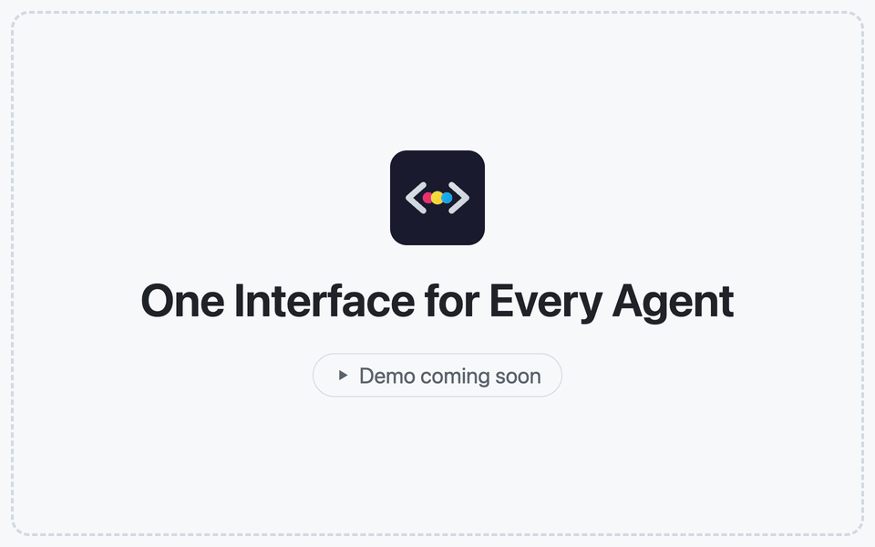
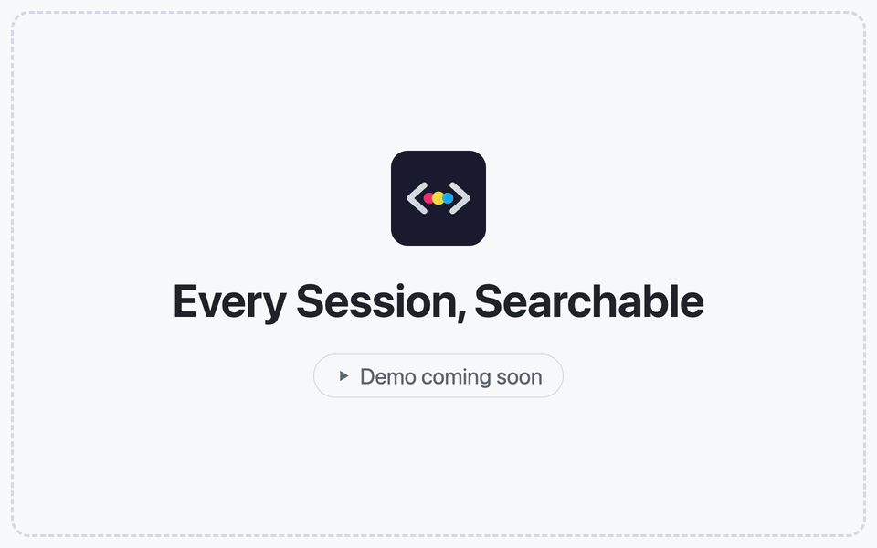
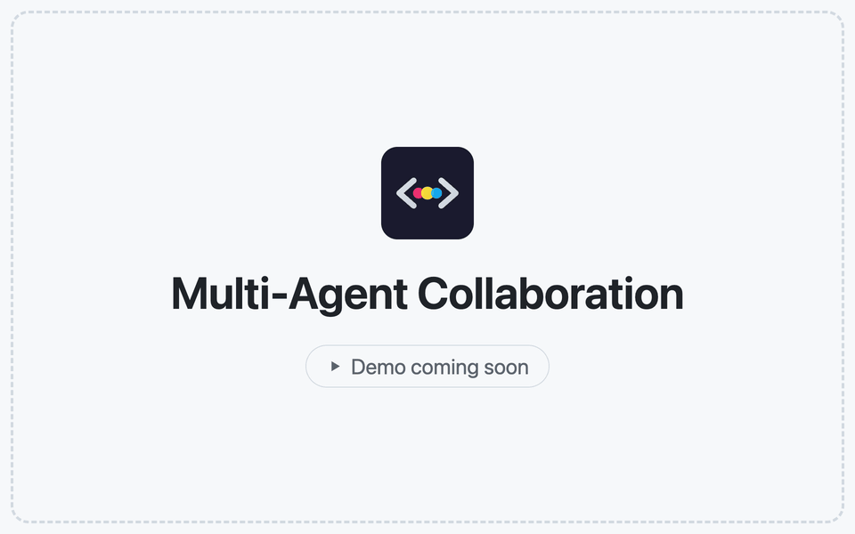
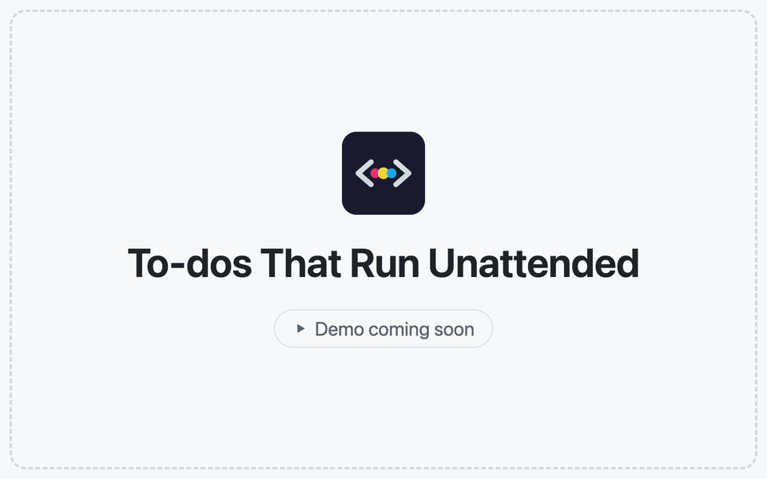
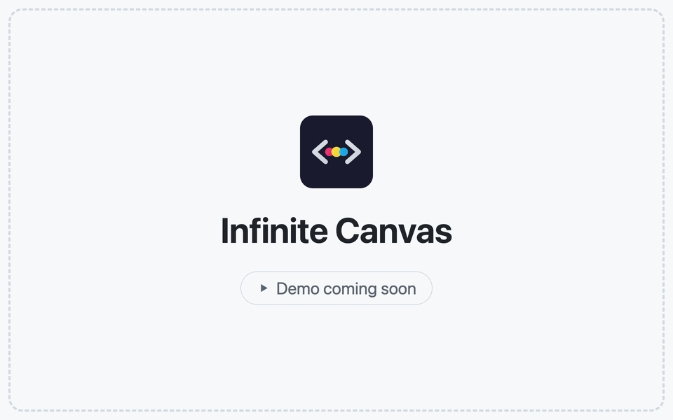
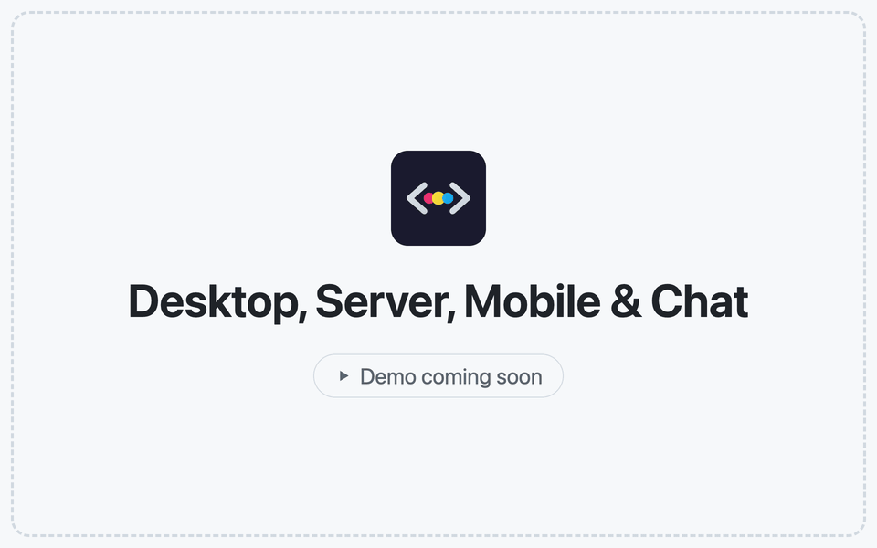
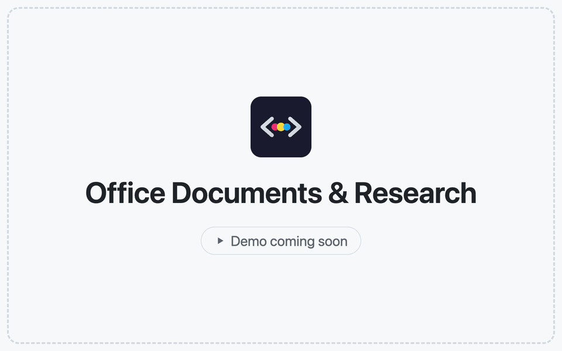
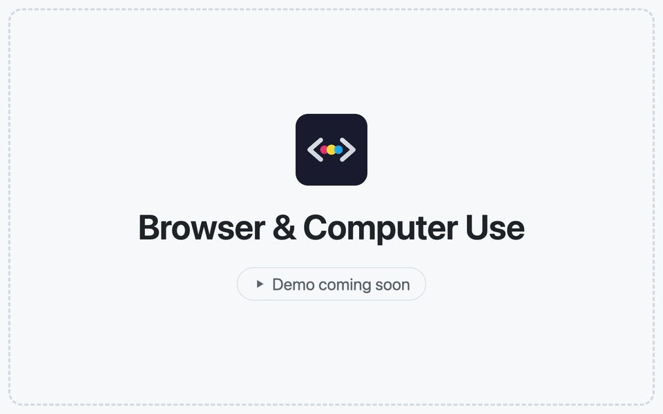

<h1 align="center">
  <a href="https://docs.codeg.app"></a> Codeg
</h1>

<p align="center">
  <a href="https://github.com/icannotwait/MyCodeBuddy"></a>
  <a href="https://github.com/icannotwait/MyCodeBuddy/releases/latest"></a>
  <a href="https://github.com/icannotwait/MyCodeBuddy/releases"></a>
  <a href="../../LICENSE"></a>
  <a href="https://docs.codeg.app"></a>
  <a href="https://docs.codeg.app/getting-started/installation"></a>
</p>

<p align="center">
  <sub><a href="../../README.md">English</a> · <a href="./README.zh-CN.md">简体中文</a> · <a href="./README.zh-TW.md">繁體中文</a> · <a href="./README.ja.md">日本語</a> · <strong>한국어</strong> · <a href="./README.es.md">Español</a> · <a href="./README.de.md">Deutsch</a> · <a href="./README.fr.md">Français</a> · <a href="./README.pt.md">Português</a> · <a href="./README.ar.md">العربية</a></sub>
</p>

<p align="center">
  <strong>멀티 에이전트 코딩 워크스페이스.</strong><br/>
  모든 AI 코딩 에이전트를 한곳에서 실행하고, 서로 협업하게 만듭니다.
</p>

<p align="center"><sub>Windows용 DrawCode는 <a href="https://github.com/icannotwait/MyCodeBuddy">MyCodeBuddy</a>에서 배포합니다.</sub></p>

<h3 align="center"><a href="https://github.com/icannotwait/MyCodeBuddy/releases/latest"><ins>DrawCode 다운로드</ins></a> · <a href="https://docs.codeg.app"><ins>문서</ins></a></h3>

<p align="center">
  <picture>
    <source media="(prefers-color-scheme: dark)" srcset="../images/workspace-dark.png" />
    
  </picture>
</p>

<table>
  <tr>
    <td width="50%" valign="top">🧩 <strong>모든 에이전트를 하나의 인터페이스로</strong><br/>스무 개의 에이전트가 기본 내장되어 있고, ACP 에이전트라면 무엇이든 합류할 수 있습니다 — 모두 터미널이 아닌, 같은 구조화된 대화로 표시됩니다.</td>
    <td width="50%" valign="top">🔎 <strong>에이전트를 넘나드는 세션</strong><br/>에이전트마다 디스크에 남겨 두는 기록을 가져와 검색하고 이어서 진행한 다음, 다른 에이전트에게 넘겨주세요.</td>
  </tr>
  <tr>
    <td width="50%" valign="top">🤝 <strong>함께 일하는 에이전트</strong><br/><code>@</code> 하나로 에이전트 간에 작업을 위임하거나, 각자의 워크트리에서 무인으로 실행되는 할 일을 대기열에 넣으세요.</td>
    <td width="50%" valign="top">🌍 <strong>어디서 일하든</strong><br/>데스크톱 앱, 자체 호스팅 서버나 Docker, iPhone, iPad, Android에서 — 그리고 Telegram, Lark 또는 WeChat에서도.</td>
  </tr>
</table>

## ✨ 주요 기능

<table>
<tr>
<td width="50%" valign="middle">

### 모든 에이전트를 하나의 인터페이스로

스무 개의 에이전트가 기본 내장되어 있고, 그 밖의 ACP 에이전트도 공개 레지스트리나 자체 distribution JSON으로 합류할 수 있습니다. Codeg는 이들 모두와 Agent Client Protocol로 통신하므로, 눈을 가늘게 뜨고 들여다봐야 하는 터미널 대신 모두 같은 풍부한 대화 화면을 갖게 됩니다 — 도구 카드, 실시간 diff, 계획, 권한 요청까지.

[문서 →](https://docs.codeg.app/guide/supported-agents) · [커스텀 에이전트 →](https://docs.codeg.app/guide/custom-agents) · [UI 렌더링 →](https://docs.codeg.app/guide/skills#cards-tables-and-charts-in-replies)

</td>
<td width="50%">
<picture>
  <source media="(prefers-color-scheme: dark)" srcset="../images/features/agents-dark.gif" />
  
</picture>
</td>
</tr>
<tr>
<td width="50%" valign="middle">

### 모든 세션을 검색할 수 있게

기록을 가져오고 검색하고 이어서 대화하세요. `@`로 다른 에이전트와 세션을 공유하고 태그로 정리하세요.

[문서 →](https://docs.codeg.app/guide/aggregation) · [태그 →](https://docs.codeg.app/guide/workspace#tag-conversations)

</td>
<td width="50%">
<picture>
  <source media="(prefers-color-scheme: dark)" srcset="../images/features/sessions-dark.gif" />
  
</picture>
</td>
</tr>
<tr>
<td width="50%" valign="middle">

### 멀티 에이전트 협업

`@`로 작업을 위임하세요. 여러 에이전트가 나란히 작업하고 진행 상황을 대화에 실시간으로 전합니다.

[문서 →](https://docs.codeg.app/guide/multi-agent)

</td>
<td width="50%">
<picture>
  <source media="(prefers-color-scheme: dark)" srcset="../images/features/multi-agent-dark.gif" />
  
</picture>
</td>
</tr>
<tr>
<td width="50%" valign="middle">

### 무인으로 실행되는 할 일

독립된 워크트리에서 작업을 즉시 실행하거나 예약하세요. 에이전트가 작업하면 변경 사항을 검토하고 승인하세요.

[문서 →](https://docs.codeg.app/guide/tasks) · [자동 처리 →](https://docs.codeg.app/guide/repository#let-it-pick-items-up-by-itself)

</td>
<td width="50%">
<picture>
  <source media="(prefers-color-scheme: dark)" srcset="../images/features/todos-dark.gif" />
  
</picture>
</td>
</tr>
<tr>
<td width="50%" valign="middle">

### 무한 캔버스

대화, 파일, 터미널, 메모를 무한한 보드에 배치하세요. 모든 에이전트의 작업을 한눈에 볼 수 있습니다.

[문서 →](https://docs.codeg.app/guide/canvas)

</td>
<td width="50%">
<picture>
  <source media="(prefers-color-scheme: dark)" srcset="../images/features/canvas-dark.gif" />
  
</picture>
</td>
</tr>
<tr>
<td width="50%" valign="middle">

### 데스크톱·서버·모바일·채팅

데스크톱, 서버, Docker, 모바일에서 사용하세요. Telegram, Lark, WeChat으로도 에이전트와 대화하세요.

[문서 →](https://docs.codeg.app/getting-started/deployment) · [원격 워크스페이스 →](https://docs.codeg.app/guide/workspace#desktop-and-browser) · [모바일 앱 →](https://docs.codeg.app/getting-started/installation#mobile-apps) · [채팅 채널 →](https://docs.codeg.app/guide/chat-channels)

</td>
<td width="50%">
<picture>
  <source media="(prefers-color-scheme: dark)" srcset="../images/features/anywhere-dark.gif" />
  
</picture>
</td>
</tr>
<tr>
<td width="50%" valign="middle">

### Office 문서와 과학 연구

Office 파일을 만들고 실시간으로 미리 보며 PDF도 열어 보세요. 연구 스킬은 모든 에이전트가 사용합니다.

[문서 →](https://docs.codeg.app/guide/office) · [과학 연구 →](https://docs.codeg.app/guide/research)

</td>
<td width="50%">
<picture>
  <source media="(prefers-color-scheme: dark)" srcset="../images/features/office-dark.gif" />
  
</picture>
</td>
</tr>
<tr>
<td width="50%" valign="middle">

### 브라우저와 컴퓨터 사용

데스크톱 브라우저에서 페이지와 오류를 공유하세요. 컴퓨터 사용(미리보기)으로 공유 창도 조작할 수 있습니다.

[문서 →](https://docs.codeg.app/guide/browser) · [컴퓨터 사용 →](https://docs.codeg.app/guide/computer-use)

</td>
<td width="50%">
<picture>
  <source media="(prefers-color-scheme: dark)" srcset="../images/features/browser-dark.gif" />
  
</picture>
</td>
</tr>
<tr>
<td width="50%" valign="middle">

### 명령줄과 CI

`codeg-cli`로 스크립트나 CI에서 실행 중인 Codeg에 요청하세요. 응답이나 JSON 이벤트를 출력합니다.

[문서 →](https://docs.codeg.app/guide/command-line)

</td>
<td width="50%" valign="middle">

```bash
codeg-cli -a codex \
  -p "Review the latest commit"

git diff | codeg-cli -a codex \
  -p "Review this diff"
```

</td>
</tr>
</table>

**함께 들어 있는 기능:**

- **[엔지니어링의 전 과정](https://docs.codeg.app/guide/workspace)** — 코드 편집기, 실시간 diff, [Git과 워크트리](https://docs.codeg.app/guide/git), 3패널 병합 편집기, 터미널, 분할 보기
- **[리포지토리 패널](https://docs.codeg.app/guide/repository)** — GitHub, GitLab, Gitea, Forgejo의 이슈, 풀 리퀘스트, 검사 항목, 병합을 다루고, 어떤 이슈나 PR이든 할 일로 만들 수 있습니다
- **[자동화](https://docs.codeg.app/guide/automations)** — 설정을 마친 입력창을 저장해 cron 일정에 따라 또는 필요할 때 헤드리스로 실행합니다
- **[토큰 사용량](https://docs.codeg.app/guide/token-usage)** — 추이, 캐시 적중률, 활동 히트맵, 폴더·에이전트·모델·세션별 사용량, 그리고 API 정가 기준 예상 비용
- **[분기와 끼어들기](https://docs.codeg.app/guide/workspace#follow-along-%E2%80%94-the-conversation)** — 지원하는 에이전트에서는 완료된 답변에서 대화를 분기하거나, 아직 실행 중인 턴에 메시지를 끼워 넣을 수 있습니다
- **[스킬](https://docs.codeg.app/guide/skills) & [MCP](https://docs.codeg.app/guide/mcp)** — 에이전트별 스킬 팩, 로컬 MCP 스캔, 레지스트리 검색과 설치
- **[프로젝트 부트](https://docs.codeg.app/guide/project-boot)** — 실시간 미리보기와 함께 새 프로젝트의 뼈대를 시각적으로 만듭니다
- **[알림](https://docs.codeg.app/reference/settings/general#desktop-notifications)** — 턴이 끝나거나 에이전트가 나를 필요로 할 때 데스크톱 알림과 알림음, 깜박이는 작업 표시줄 버튼, 튀어 오르는 Dock 아이콘으로 알려 줍니다
- **[내 취향대로](https://docs.codeg.app/reference/settings/appearance)** — 토큰 단위로 색을 바꿀 수 있는 열두 가지 테마, 배경화면, 모서리 둥글기, 채팅 너비, 사용자 지정 CSS, 데스크톱 펫 — 열 가지 인터페이스 언어 중 어느 언어로든
- **[백업과 동기화](https://docs.codeg.app/reference/settings/system#backup-restore)** — 암호화된 백업, 그리고 파일이나 직접 운영하는 WebDAV 서버를 통한 컴퓨터 간 설정 동기화
- **[URL 스킴](../../docs/url-scheme.md)** — `codeg://session/<id>`로 다른 앱에서 대화를 엽니다(데스크톱)
- **그 밖에도** — 거의 모든 릴리스마다 새로운 것이 더해집니다. 전체 목록은 [릴리스 노트](https://github.com/icannotwait/MyCodeBuddy/releases)에 있습니다

## 🤖 지원 에이전트

Codeg는 모든 에이전트와 [Agent Client Protocol](https://agentclientprotocol.com)로 통신하므로, 에이전트마다 같은 구조화된 인터페이스를 갖습니다. 스무 개가 기본 내장되어 있으며, 그중 대부분은 Codeg가 대신 설치하고, 버전을 고정하고, 업데이트합니다:

<p>
  <a href="https://www.anthropic.com/claude-code"><kbd> Claude Code</kbd></a> &nbsp;
  <a href="https://github.com/openai/codex"><kbd> Codex</kbd></a> &nbsp;
  <a href="https://github.com/google-gemini/gemini-cli"><kbd> Gemini CLI</kbd></a> &nbsp;
  <a href="https://opencode.ai"><kbd><picture><source media="(prefers-color-scheme: dark)" srcset="../images/agents/opencode-dark.svg" /></picture> OpenCode</kbd></a> &nbsp;
  <a href="https://cline.bot"><kbd><picture><source media="(prefers-color-scheme: dark)" srcset="../images/agents/cline-dark.svg" /></picture> Cline</kbd></a> &nbsp;
  <a href="https://hermes-agent.nousresearch.com"><kbd><picture><source media="(prefers-color-scheme: dark)" srcset="../images/agents/hermes-agent-dark.svg" /></picture> Hermes Agent</kbd></a> &nbsp;
  <a href="https://www.codebuddy.ai"><kbd><picture><source media="(prefers-color-scheme: dark)" srcset="../images/agents/codebuddy-dark.svg" /></picture> CodeBuddy</kbd></a> &nbsp;
  <a href="https://www.kimi.com/code"><kbd> Kimi Code</kbd></a> &nbsp;
  <a href="../agents/minimax-code.md"><kbd> MiniMax Code</kbd></a> &nbsp;
  <a href="https://pi.dev"><kbd> Pi</kbd></a> &nbsp;
  <a href="https://x.ai/cli"><kbd><picture><source media="(prefers-color-scheme: dark)" srcset="../images/agents/grok-dark.svg" /></picture> Grok</kbd></a> &nbsp;
  <a href="https://cursor.com/cli"><kbd><picture><source media="(prefers-color-scheme: dark)" srcset="../images/agents/cursor-dark.svg" /></picture> Cursor</kbd></a> &nbsp;
  <a href="https://deepseek-harness.github.io/deepseek-harness/"><kbd> DeepSeek Harness</kbd></a> &nbsp;
  <a href="https://qoder.com"><kbd><picture><source media="(prefers-color-scheme: dark)" srcset="../images/agents/qoder-dark.svg" /></picture> Qoder</kbd></a> &nbsp;
  <a href="https://antigravity.google"><kbd><picture><source media="(prefers-color-scheme: dark)" srcset="../images/agents/google-antigravity-dark.svg" /></picture> Google Antigravity</kbd></a> &nbsp;
  <a href="https://kiro.dev/cli/"><kbd> Kiro CLI</kbd></a> &nbsp;
  <a href="../agents/zcode.md"><kbd> ZCode</kbd></a> &nbsp;
  <a href="https://docs.trae.cn/cli_about-trae-code-cli-2"><kbd> TRAE CLI</kbd></a> &nbsp;
  <a href="https://commandcode.ai"><kbd> Command Code</kbd></a> &nbsp;
  <a href="https://docs.codeg.app/guide/custom-agents"><kbd>+ 모든 ACP 에이전트</kbd></a>
</p>

목록에 없나요? 공개 ACP 레지스트리에서 아무 에이전트나 고르거나, 그 에이전트의 distribution JSON을 붙여넣으세요 — Codeg가 설치하고, 실행되는지 확인한 뒤, 내장 에이전트처럼 다룹니다. 각 에이전트의 실행 환경 요구 사항과 세션 보관 위치는 [지원 에이전트](https://docs.codeg.app/guide/supported-agents)를 참고하세요.

## 🪟 화면 분할

탭 한 줄로는 부족할 때가 있습니다. 대화 탭을 오른쪽 클릭하면 뷰를 **오른쪽**이나 **아래쪽**으로, 원하는 만큼 몇 번이든 분할할 수 있습니다. 좌우 두 칸, 위아래 세 칸, 아니면 격자 전체로도요. 각 그룹은 그 자체로 하나의 워크스페이스입니다 — 자기 탭, 자기 헤더, 자기 새 대화 버튼을 가집니다. 그래서 한 칸에서는 Claude Code가 리팩터링하고, 옆 칸에서는 Codex가 diff를 검토할 수 있습니다.

탭을 다른 그룹으로 끌어다 놓아도 그 세션은 이동 중에도 계속 스트리밍됩니다. 두 그룹 사이의 구분선을 끌면 공간을 나누는 비율이 바뀝니다. 레이아웃은 워크스페이스별로, 초안까지 함께 기억됩니다. Codeg를 다시 열면 분할이 그대로 돌아오고, 보내지 않은 글도 입력창에 남아 있습니다.


## 📦 설치

**데스크톱** — 이 저장소의 GitHub Releases는 Windows용 **DrawCode**(NSIS)를 배포합니다. 일상적인 사용에는 데스크톱 설치 프로그램을 쓰세요.

**서버** — `codeg-server`는 직접 호스팅할 때만 쓰는 선택 기능입니다(Cargo feature `server`). 데스크톱 사용자는 DrawCode를 설치합니다. Windows(PowerShell):

```powershell
.\uninstall-server.ps1
# or:
irm https://raw.githubusercontent.com/icannotwait/MyCodeBuddy/main/uninstall-server.ps1 | iex

.\install.ps1 -Version v0.45.0-mycodebuddy.1
# or:
irm https://raw.githubusercontent.com/icannotwait/MyCodeBuddy/main/install.ps1 | iex
$env:CODEG_STATIC_DIR="$env:LOCALAPPDATA\codeg-server\web"; codeg-server
```

설치 프로그램의 기본 디렉터리는 `%LOCALAPPDATA%\codeg-server`라서 DrawCode 데스크톱 설치를 덮어쓰지 않습니다. 이전 설치가 데스크톱 폴더에 있으면 스크립트가 서버를 그 밖으로 옮깁니다.

[GitHub Releases](https://github.com/icannotwait/MyCodeBuddy/releases)는 셀프 호스팅용 서명된 서버 압축 파일도 제공합니다: `codeg-server-linux-x64.tar.gz`, `codeg-server-linux-arm64.tar.gz`, `codeg-server-darwin-x64.tar.gz`, `codeg-server-darwin-arm64.tar.gz`, `codeg-server-windows-x64.zip`. 각 파일에는 서버, MCP 동반 프로세스, 컴퓨터 제어 헬퍼, `web/` 자산과 라이선스 파일이 포함됩니다.

**Docker** — 선택적 서버를 이 저장소에서 빌드합니다:

```bash
docker compose up -d
```

Docker Compose는 이미지를 로컬에서 빌드하고 Cargo feature `server`를 켭니다. 데이터는 `/data` 볼륨에 남고, 토큰·포트·프로젝트 마운트는 `docker-compose.yml`에서 설정합니다.

**소스에서 빌드** — `codeg-server`에는 `--features server`가, `codeg-mcp`에는 `--features mcp-bin`이 필요합니다:

```bash
pnpm install && pnpm build
cd src-tauri
cargo build --release --bin codeg-server --no-default-features --features server
cargo build --release --bin codeg-mcp --no-default-features --features mcp-bin
# 컴퓨터 제어를 활성화한 경우에만:
cargo build --release --bin codeg-computer-helper --no-default-features --features computer-helper
CODEG_STATIC_DIR=../out ./target/release/codeg-server
```

**Linux/macOS 소스 빌드 업그레이드** — 저장소 루트에서 실행하여 소스를 가져오고 다시 빌드하세요:

```bash
git pull
pnpm install && pnpm build
cd src-tauri
cargo build --release --bin codeg-server --no-default-features --features server
cargo build --release --bin codeg-mcp --no-default-features --features mcp-bin
# 컴퓨터 제어를 활성화한 경우에만:
cargo build --release --bin codeg-computer-helper --no-default-features --features computer-helper
# 서비스를 중지하고 서버, MCP 동반 프로세스, 선택적 컴퓨터 헬퍼와 웹 자산을 다시 배포한 뒤 재시작하세요.
```

Docker 업그레이드는 저장소 루트에서 `git pull && docker compose up --build -d --force-recreate`를 실행하세요.

**모바일** — [iOS 앱](https://apps.apple.com/app/codeg-client/id6785199071) 또는 [Android APK](https://github.com/xintaofei/codeg-android/releases/latest)를 설치한 뒤 데스크톱 앱의 **웹 서비스**나 직접 운영하는 `codeg-server`를 가리키게 하세요: 주소와 토큰만 넣으면 끝입니다. 연결 절차는 [모바일 앱](https://docs.codeg.app/getting-started/installation#mobile-apps) 참고.

Compose, 사전 빌드 바이너리, 소스 빌드, 제자리 업데이트는 [배포](https://docs.codeg.app/getting-started/deployment)에서, 환경 변수는 [설정](https://docs.codeg.app/getting-started/configuration)에서 다룹니다.

## 👥 커뮤니티와 지원

- **WeChat** — QR 코드를 스캔하여 토론, 피드백, 업데이트를 위한 그룹에 참여하세요:

  <picture>
    <source media="(prefers-color-scheme: dark)" srcset="../images/weixin-dark.jpg" />
    
  </picture>

- **이슈** — 버그를 찾았거나 원하는 기능이 없나요? [이슈를 열어 주세요](https://github.com/icannotwait/MyCodeBuddy/issues).
- **개인정보 보호** — 로컬 우선: 파싱, 저장, 프로젝트 작업은 내 컴퓨터 안에서 이루어지고, 웹 모드와 서버 모드는 토큰 기반 인증으로 보호됩니다. 자세한 내용은 [개인정보 보호 및 보안](https://docs.codeg.app/reference/privacy)을 참고하세요.
- **LinuxDO** — [LinuxDO](https://linux.do) 커뮤니티의 지원에 감사드립니다.
- **응원하기** — [저장소에 스타를 눌러](https://github.com/icannotwait/MyCodeBuddy) 진행 상황을 함께 지켜봐 주세요.

## 🤝 기여하기

이슈와 풀 리퀘스트를 환영합니다. Codeg를 직접 빌드하려면 [개발](https://docs.codeg.app/reference/development)과 [아키텍처](https://docs.codeg.app/reference/architecture)부터 살펴보세요.

<a href="https://github.com/icannotwait/MyCodeBuddy/graphs/contributors">
  
</a>

## ⭐ 스타 히스토리

<a href="https://www.star-history.com/?repos=icannotwait%2FMyCodeBuddy&type=date&releases=&legend=bottom-right">
 <picture>
   <source media="(prefers-color-scheme: dark)" srcset="https://api.star-history.com/chart?repos=icannotwait/MyCodeBuddy&type=date&theme=dark&legend=bottom-right" />
   <source media="(prefers-color-scheme: light)" srcset="https://api.star-history.com/chart?repos=icannotwait/MyCodeBuddy&type=date&legend=bottom-right" />
   
 </picture>
</a>

## 🙏 감사의 말

- MyCodeBuddy는 DrawCode를 배포하는, 원래 Codeg 프로젝트의 포크입니다. 릴리스와 설치 프로그램은 이 저장소에서 제공합니다.

- [Agent Client Protocol](https://agentclientprotocol.com) — Codeg가 지원하는 모든 에이전트에 연결할 수 있게 해주는 토대
- [Superpowers](https://github.com/obra/superpowers) — Codeg의 전문가 스킬 모듈을 지원하는 프로젝트
- [OfficeCLI](https://github.com/iOfficeAI/OfficeCLI) — Codeg의 Office 문서 워크플로우를 지원하는 프로젝트
- [scientific-agent-skills](https://github.com/K-Dense-AI/scientific-agent-skills) — Codeg의 과학 연구 스킬을 지원하는 프로젝트 (MIT 라이선스 서브셋)
- [json-render](https://github.com/vercel-labs/json-render) — Codeg의 UI 렌더링(카드, 표, 차트)을 지원하는 프로젝트
- [cua-driver](https://github.com/trycua/cua) — Codeg의 컴퓨터 사용을 지원하는 프로젝트

## 📜 라이선스

Apache-2.0. [LICENSE](../../LICENSE)를 참고하세요.
